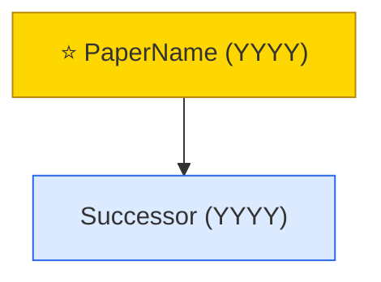
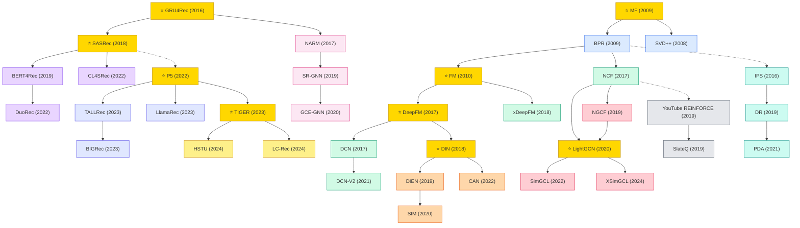

# Recommendation Systems Domain Implementation Plan

> **For agentic workers:** REQUIRED SUB-SKILL: Use superpowers:subagent-driven-development (recommended) or superpowers:executing-plans to implement this plan task-by-task. Steps use checkbox (`- [ ]`) syntax for tracking.

**Goal:** Add a comprehensive `domains/recommendation/` directory to the awesome-ml-papers repo, organized into 10 paradigm subdirectories (cf-mf, deep-rec, ctr-ranking, sequential-rec, session-rec, graph-rec, llm4rec, generative-rec, debias-causal, rl-rec) with per-paradigm READMEs (mermaid tech trees), classic.md files, and year-based paper lists from 2016 to 2026.

**Architecture:** Content-curation task. Each task produces one or more markdown files following the conventions established by `domains/graph/` and `domains/nlp/`. Mermaid diagrams are validated visually (preview in the github.com renderer). No code to test — verification is link validity, mermaid syntax, and structural consistency with sibling domains.

**Tech Stack:** Markdown, Mermaid (github-flavored), GitHub-standard link syntax.

**Spec:** `docs/superpowers/specs/2026-04-18-recommendation-domain-design.md`

---

## Conventions for All Tasks

### Paper Entry Format

Each paper in a year file or classic.md uses this format:

```markdown
### <Paper Title>
- **Authors:** <First Author et al.>
- **Venue:** <VENUE YEAR>
- **Paper:** [arXiv](<link>) / [Proceedings](<link>)
- **Code:** [GitHub](<link>)  <!-- omit line if no official code -->
- **Summary:** <1-2 sentences on contribution>
- **Tags:** `#tag1` `#tag2`
```

### Year File Header

```markdown
# YYYY — <Paradigm Name> Papers

<Optional 1-line overview>

## <Sub-branch Name, e.g., "Transformer-based">

<Papers in this sub-branch>

## <Another Sub-branch>

<Papers>
```

### Mermaid Convention

Match the style used in `domains/graph/README.md`:



- Classic/flagship papers get `⭐` prefix and the `star` class
- Dashed arrows `-.->` denote loose influence, solid arrows `-->` denote direct lineage
- 8-color palette max per diagram; reuse colors for semantic groupings
- **Reserved keywords** — NEVER use `graph`, `flowchart`, `sequenceDiagram`, `gantt`, `end`, or `subgraph` as `classDef` names (parser conflict). Use `gnn` instead of `graph`, `seq` instead of `sequenceDiagram`, etc.

### Commit Style

- One commit per task unless noted
- Message: `docs(recommendation): <paradigm> <what>` (e.g., `docs(recommendation): scaffold cf-mf paradigm`)
- Trailer: `Co-Authored-By: Claude Opus 4.7 <noreply@anthropic.com>`

### Verification per Task

After each task, run:
```bash
git diff --stat HEAD~1
ls domains/recommendation/<paradigm>/
```
Confirm files exist at expected paths. For READMEs, paste the mermaid block into https://mermaid.live to verify it renders.

---

## Task 1: Root README + Top-level Recommendation README

**Files:**
- Modify: `README.md` (root, add domain row)
- Create: `domains/recommendation/README.md`

- [ ] **Step 1: Update root README domain table**

Edit `README.md:10-21` — add a row after the Signal Processing row:

```markdown
| [Recommendation Systems](domains/recommendation/) | Collaborative filtering, CTR prediction, sequential/session/graph/LLM-based/generative recommendation |
```

- [ ] **Step 2: Create `domains/recommendation/README.md`**

Create the file with these sections in order:

1. **Title + intro paragraph** — "A collection of must-read recommendation system papers from top venues (SIGIR, RecSys, KDD, WWW, NeurIPS, ICML, ICLR, CIKM, AAAI, IJCAI, ACL, TOIS). Organized into 10 paradigm subdirectories..."

2. **Cross-paradigm Tech Tree** — mermaid diagram, 25-35 nodes, one representative per paradigm per era, cross-paradigm edges for key influence. Template:



3. **Paradigm Guide** — badge table, one row per paradigm:

```markdown
| Paradigm | Description |
|:---|:---|
|  | Collaborative filtering and matrix factorization — the foundational paradigm |
|  | Deep neural architectures for feature interaction learning |
|  | Click-through rate prediction and industrial ranking systems |
|  | Modeling long-term user behavior sequences |
|  | Short anonymous session-based recommendation |
|  | GNN-based recommendation via user-item interaction graphs |
|  | Large language models applied to recommendation |
|  | Generative retrieval, semantic IDs, and generative recommenders |
|  | Bias correction, fairness, and causal inference for recommendation |
|  | Reinforcement learning for long-term user value optimization |
|  | Pioneering works with high impact, foundational to the field |
```

4. **Benchmark Datasets** — grouped tables:

```markdown
### General / Academic

| Dataset | Users / Items / Interactions | Description |
|:---|:---|:---|
| **MovieLens (100K / 1M / 10M / 20M / 25M)** | varying | De facto academic benchmark for CF, sequential, and graph methods |
| **Amazon Reviews (Beauty / Sports / Toys / Books / Clothing)** | varying | Large-scale review datasets; standard for sequential and LLM4Rec |
| **Yelp** | ~1.9M / 150K / 8M+ | User reviews of businesses; popular for graph-based methods |
| **Gowalla** | 30K / 41K / 1M | Location check-in graph; LightGCN-era benchmark |
| **Last.FM** | 2K / 18K / 93K | Music listening; HetRec and social rec benchmark |
| **Book-Crossing** | 280K / 271K / 1.1M | Book rating network |

### CTR / Industrial Advertising

| Dataset | Scale | Description |
|:---|:---|:---|
| **Criteo** | 45M ads | Standard CTR benchmark for feature-interaction models |
| **Avazu** | 40M impressions | Mobile ad click prediction |
| **iPinYou** | 19.5M bids | RTB click + conversion |
| **KuaiRand / KuaiSAR** | — | Kuaishou short-video click and search+recommend dataset with unbiased evaluation |

### Industrial / Large-Scale

| Dataset | Description |
|:---|:---|
| **Taobao User Behavior** | 100M interactions for CTR / sequential rec |
| **Alibaba Ads** | Production ad dataset released with DIN/DIEN papers |
| **Tenrec** | 5M users / 140M interactions; Tencent benchmark for 10+ tasks |

### Sequential / Session

| Dataset | Description |
|:---|:---|
| **Diginetica** | E-commerce session clicks; RecSys 2016 Challenge |
| **YooChoose** | E-commerce session clicks; RecSys 2015 Challenge |
| **RetailRocket** | E-commerce session/transaction |

### News & Text-Attributed

| Dataset | Description |
|:---|:---|
| **MIND (small / large)** | Microsoft news recommendation with article text |
| **Adressa** | Norwegian news click stream |
```

5. **Evaluation Metrics** — table:

```markdown
| Metric | Used For | Definition |
|:---|:---|:---|
| **HR@K** | Top-K | Hit rate at K |
| **NDCG@K** | Top-K | Normalized discounted cumulative gain at K |
| **Recall@K** | Top-K | Recall among top K |
| **MRR** | Top-K | Mean reciprocal rank |
| **AUC / GAUC** | CTR | Area under ROC / group-weighted AUC |
| **Coverage / Diversity / Novelty / Serendipity** | Top-K | Beyond-accuracy metrics |
```

6. **Contents** — links:

```markdown
## Contents

- [Collaborative Filtering & Matrix Factorization](cf-mf/)
- [Deep Recommenders](deep-rec/)
- [CTR Prediction & Ranking](ctr-ranking/)
- [Sequential Recommendation](sequential-rec/)
- [Session-based Recommendation](session-rec/)
- [Graph-based Recommendation](graph-rec/)
- [LLM for Recommendation](llm4rec/)
- [Generative Recommendation](generative-rec/)
- [Debiasing / Fairness / Causal](debias-causal/)
- [Reinforcement Learning for Recommendation](rl-rec/)
```

- [ ] **Step 3: Verify mermaid renders**

Paste the tech-tree mermaid block into https://mermaid.live. Confirm all 10 paradigm colors distinct, no unresolved refs. Fix any syntax errors inline.

- [ ] **Step 4: Commit**

```bash
git add README.md domains/recommendation/README.md
git commit -m "docs(recommendation): add top-level README with cross-paradigm tech tree

Co-Authored-By: Claude Opus 4.7 <noreply@anthropic.com>"
```

---

## Task 2: Scaffold cf-mf paradigm

**Files:**
- Create: `domains/recommendation/cf-mf/README.md`
- Create: `domains/recommendation/cf-mf/classic.md`

- [ ] **Step 1: Create `cf-mf/README.md`**

Structure:

```markdown
# Collaborative Filtering & Matrix Factorization

The foundational paradigm of recommendation systems. Models user-item interactions via latent-factor decomposition or neighborhood methods.

## Tech Tree

\```mermaid
graph TD
    classDef neighbor fill:#DBEAFE,stroke:#2563EB
    classDef latent fill:#D1FAE5,stroke:#059669
    classDef ranking fill:#FED7AA,stroke:#EA580C
    classDef fm fill:#E9D5FF,stroke:#7C3AED
    classDef star fill:#FFD700,stroke:#B8860B

    ItemCF["⭐ Item-based CF (2001)"]:::star --> SlopeOne["Slope One (2005)"]:::neighbor
    NetflixMF["⭐ Matrix Factorization (2007-2009)"]:::star --> SVDpp["SVD++ (2008)"]:::latent
    NetflixMF --> BPR["⭐ BPR (2009)"]:::star
    BPR --> WRMF["WRMF / eALS (2014)"]:::ranking
    SVDpp --> FM["⭐ FM (2010)"]:::star
    FM --> FFM["FFM (2016)"]:::fm
    FM --> AFM["AFM (2017)"]:::fm
    FM --> NFM["NFM (2017)"]:::fm
\```

### Paradigm Legend
| Color | Meaning |
|:---|:---|
|  | Item/user-based CF |
|  | SVD, SVD++, biased MF |
|  | BPR, WRMF, eALS |
|  | FM family |

## Contents
- [Classic Papers](classic.md) — 1994–2015 foundational works
- [2017](2017.md)
- [2018](2018.md)
- [2019](2019.md)
- [misc](misc.md) — sparse years combined
```

- [ ] **Step 2: Create `cf-mf/classic.md`**

Include these papers with full entries:

| Title | Venue | Year | Key Idea |
|---|---|---|---|
| GroupLens | CSCW | 1994 | Original user-based CF |
| Item-based Collaborative Filtering | WWW | 2001 | Item similarity for CF |
| Amazon item-to-item | IEEE Internet | 2003 | Production item-item CF |
| Slope One | SDM | 2005 | Simple rating predictor |
| Regularized MF | KDD | 2008 | Netflix Prize latent factor model |
| SVD++ | KDD | 2008 | MF with implicit feedback |
| BPR | UAI | 2009 | Bayesian personalized ranking |
| Factorization Machines | ICDM | 2010 | Generic second-order interactions |
| iALS / WRMF | ICDM | 2008 | Implicit feedback ALS |
| eALS | SIGIR | 2014 | Element-wise ALS for implicit feedback |

Each entry uses the "Paper Entry Format" from the Conventions section.

- [ ] **Step 3: Commit**

```bash
git add domains/recommendation/cf-mf/
git commit -m "docs(recommendation): scaffold cf-mf paradigm with classic papers

Co-Authored-By: Claude Opus 4.7 <noreply@anthropic.com>"
```

---

## Task 3: Scaffold deep-rec paradigm

**Files:**
- Create: `domains/recommendation/deep-rec/README.md`
- Create: `domains/recommendation/deep-rec/classic.md`

- [ ] **Step 1: Create `deep-rec/README.md`**

Tech tree (8-12 nodes):
- Classes: `wide_deep`, `fm_based`, `crossnet`, `attention`, `star`
- Key nodes: Wide&Deep (2016) ⭐ → DeepFM (2017) ⭐ → xDeepFM (2018) → AutoInt (2019) → DCN (2017) → DCN-V2 (2021) → FiBiNET (2019) → NCF (2017) ⭐

Intro: "Deep feature-interaction models. Build on FM by replacing shallow second-order interactions with deep networks."

Legend colors match classes.

Contents list includes classic.md + year files from 2016 onward (create only when populated).

- [ ] **Step 2: Create `deep-rec/classic.md`**

Note at top: "This paradigm is post-2015. The 'classic' works here are the 2016-2017 launch papers that defined the field."

Papers (full entries):
- NCF (WWW 2017) — ⭐ Neural Collaborative Filtering
- Wide & Deep Learning (DLRS 2016) — ⭐ memorization + generalization
- DeepFM (IJCAI 2017) — ⭐ FM + DNN joint training
- Deep Crossing (KDD 2016) — residual nets for feature interaction

- [ ] **Step 3: Commit**

```bash
git add domains/recommendation/deep-rec/
git commit -m "docs(recommendation): scaffold deep-rec paradigm

Co-Authored-By: Claude Opus 4.7 <noreply@anthropic.com>"
```

---

## Task 4: Scaffold ctr-ranking paradigm

**Files:**
- Create: `domains/recommendation/ctr-ranking/README.md`
- Create: `domains/recommendation/ctr-ranking/classic.md`

- [ ] **Step 1: Create `ctr-ranking/README.md`**

Tech tree classes: `interest`, `multitask`, `long_seq`, `industrial`, `star`
Key nodes: DIN (2018) ⭐ → DIEN (2019) → DSIN (2019) → MIMN (2019) → SIM (2020) → ETA (2021) → CAN (2022). Parallel branch: MMoE (2018) ⭐ → PLE (2020) → STAR (2021). ESMM (2018) (multi-task conversion). DLRM (2019) ⭐ (Meta).

Intro: "CTR prediction and industrial ranking systems. Emphasis on user-interest modeling, multi-task learning, long-sequence modeling."

- [ ] **Step 2: Create `ctr-ranking/classic.md`**

Launch-era papers (2016-2018):
- Deep Interest Network / DIN (KDD 2018) ⭐
- Deep & Cross Network / DCN (ADKDD 2017)
- YouTube DNN (RecSys 2016) ⭐
- Entire Space Multi-task / ESMM (SIGIR 2018)
- MMoE (KDD 2018) ⭐
- FNN / PNN / SNN (ECIR 2016 / ICDM 2016)

- [ ] **Step 3: Commit**

```bash
git add domains/recommendation/ctr-ranking/
git commit -m "docs(recommendation): scaffold ctr-ranking paradigm

Co-Authored-By: Claude Opus 4.7 <noreply@anthropic.com>"
```

---

## Task 5: Scaffold sequential-rec paradigm

**Files:**
- Create: `domains/recommendation/sequential-rec/README.md`
- Create: `domains/recommendation/sequential-rec/classic.md`

- [ ] **Step 1: Create `sequential-rec/README.md`**

Tech tree classes: `rnn`, `cnn`, `transformer`, `contrastive`, `diffusion`, `star`
Key nodes: FPMC (2010) → GRU4Rec (2016) ⭐ → Caser (2018) → SASRec (2018) ⭐ → BERT4Rec (2019) → TiSASRec (2020) → S³-Rec (2020) → CL4SRec (2022) → DuoRec (2022) → DiffRec (2023). Show edges: GRU4Rec → SASRec via Transformer adoption; SASRec → BERT4Rec via bidirectional; SASRec → CL4SRec via contrastive.

Intro: "Sequential recommendation models the user's full interaction history to predict the next item. Evolved from Markov chains (FPMC) → RNN (GRU4Rec) → Transformer (SASRec) → self-supervised and contrastive approaches."

- [ ] **Step 2: Create `sequential-rec/classic.md`**

Pre-2016 foundations:
- FPMC (WWW 2010) — factorized personalized Markov chains
- HRM (SIGIR 2015) — hierarchical representation model
- Fossil (ICDM 2016) — factored sequential prediction

- [ ] **Step 3: Commit**

```bash
git add domains/recommendation/sequential-rec/
git commit -m "docs(recommendation): scaffold sequential-rec paradigm

Co-Authored-By: Claude Opus 4.7 <noreply@anthropic.com>"
```

---

## Task 6: Scaffold session-rec paradigm

**Files:**
- Create: `domains/recommendation/session-rec/README.md`
- Create: `domains/recommendation/session-rec/classic.md`

- [ ] **Step 1: Create `session-rec/README.md`**

Tech tree: NARM (2017) → STAMP (2018) → SR-GNN (2019) ⭐ → GCE-GNN (2020) → FGNN (2019) → TAGNN (2020) → DHCN (2021) → S²-DHCN (2021) → COTREC (2021) → MSGIFSR (2022)

Classes: `rnn_attn`, `gnn`, `hypergraph`, `contrastive`, `star`

Intro: "Session-based recommendation works on short anonymous sessions (no user ID). Attention-based (NARM, STAMP) gave way to graph-based (SR-GNN) and hypergraph/contrastive methods."

- [ ] **Step 2: Create `session-rec/classic.md`**

Launch papers:
- GRU4Rec (ICLR 2016) ⭐ — first deep session recommender (also in sequential-rec classic)
- Item2Vec (RecSys 2016) — skip-gram for items
- Hierarchical RNN (RecSys 2017)

Note cross-reference: "GRU4Rec is also listed in `sequential-rec/classic.md`. Both paradigms claim it as a foundational work."

- [ ] **Step 3: Commit**

```bash
git add domains/recommendation/session-rec/
git commit -m "docs(recommendation): scaffold session-rec paradigm

Co-Authored-By: Claude Opus 4.7 <noreply@anthropic.com>"
```

---

## Task 7: Scaffold graph-rec paradigm

**Files:**
- Create: `domains/recommendation/graph-rec/README.md`
- Create: `domains/recommendation/graph-rec/classic.md`

- [ ] **Step 1: Create `graph-rec/README.md`**

Tech tree: PinSage (2018) ⭐ → NGCF (2019) → LightGCN (2020) ⭐ → UltraGCN (2021) → SimGCL (2022) → XSimGCL (2024) → LightGCL (2023) → DCCF (2023). Side branch: KGAT (2019) → KGIN (2021) (knowledge-graph aware).

Classes: `gcn`, `contrastive`, `kg`, `hypergraph`, `star`

Intro: "User-item interaction graphs with GNN message passing. Evolved from heavy-weight (PinSage, NGCF) to minimalist (LightGCN) to contrastive (SimGCL)."

- [ ] **Step 2: Create `graph-rec/classic.md`**

- PinSage (KDD 2018) ⭐ — Pinterest production GraphSAGE
- GC-MC (KDD 2018) — graph autoencoder for matrix completion
- NGCF (SIGIR 2019) — bipartite GCN for CF
- Note: "The GNN foundations (GCN, GraphSAGE, GAT) are in `domains/graph/classic.md`."

- [ ] **Step 3: Commit**

```bash
git add domains/recommendation/graph-rec/
git commit -m "docs(recommendation): scaffold graph-rec paradigm

Co-Authored-By: Claude Opus 4.7 <noreply@anthropic.com>"
```

---

## Task 8: Scaffold llm4rec paradigm

**Files:**
- Create: `domains/recommendation/llm4rec/README.md`
- Create: `domains/recommendation/llm4rec/classic.md`

- [ ] **Step 1: Create `llm4rec/README.md`**

Tech tree: P5 (2022) ⭐ → TALLRec (2023) → LlamaRec (2023) → BIGRec (2023) → RecGPT (2023) → E4SRec (2023) → LLaRA (2024) → RecExplainer (2024) → Llama4Rec (2024). Side: ChatGPT-as-Rec (2023) zero-shot studies.

Classes: `instruction_tune`, `zero_shot`, `alignment`, `embedding`, `star`

Intro: "LLMs applied to recommendation, either as zero/few-shot recommenders or fine-tuned for instruction-following over recommendation tasks."

- [ ] **Step 2: Create `llm4rec/classic.md`**

Founding works (2022-2023):
- P5 (RecSys 2022) ⭐ — prompt-based unified recommender
- M6-Rec (2022) — Chinese LLM for e-commerce
- ChatGPT as Recommender (RecSys 2023 tutorial / various)

Note: "This paradigm began in late 2022. All papers are recent."

- [ ] **Step 3: Commit**

```bash
git add domains/recommendation/llm4rec/
git commit -m "docs(recommendation): scaffold llm4rec paradigm

Co-Authored-By: Claude Opus 4.7 <noreply@anthropic.com>"
```

---

## Task 9: Scaffold generative-rec paradigm

**Files:**
- Create: `domains/recommendation/generative-rec/README.md`
- Create: `domains/recommendation/generative-rec/classic.md`

- [ ] **Step 1: Create `generative-rec/README.md`**

Tech tree: TIGER (2023) ⭐ → LC-Rec (2024) → HSTU (2024) ⭐ → GenRec (2023) → IDGenRec (2024) → COBRA (2024) → OneRec (2024). Semantic ID branch + generative retrieval branch.

Classes: `semantic_id`, `gen_retrieval`, `foundation`, `star`

Intro: "Generative recommendation treats recommendation as sequence generation: predict item IDs (or semantic codes) auto-regressively. Enables foundation-model-style scaling."

- [ ] **Step 2: Create `generative-rec/classic.md`**

- TIGER (NeurIPS 2023) ⭐ — RQ-VAE semantic IDs + T5 retrieval
- DSI (NeurIPS 2022) — generative retrieval foundation (from IR, adapted to rec)
- HSTU (2024) ⭐ — Meta's generative recommender at scale

- [ ] **Step 3: Commit**

```bash
git add domains/recommendation/generative-rec/
git commit -m "docs(recommendation): scaffold generative-rec paradigm

Co-Authored-By: Claude Opus 4.7 <noreply@anthropic.com>"
```

---

## Task 10: Scaffold debias-causal paradigm

**Files:**
- Create: `domains/recommendation/debias-causal/README.md`
- Create: `domains/recommendation/debias-causal/classic.md`

- [ ] **Step 1: Create `debias-causal/README.md`**

Tech tree: IPS (2016) → SNIPS (2015) → DR (2019) ⭐ → AutoDebias (2021) → PDA (2021) → MACR (2021) → CausalRec (2021) → DICE (2021) → CR (2022) → InvCF (2023)

Classes: `propensity`, `doubly_robust`, `causal_inference`, `fairness`, `star`

Intro: "Recommendation data is subject to popularity bias, exposure bias, selection bias, and conformity bias. This paradigm applies causal inference tools (IPS, DR, counterfactual) to debias."

- [ ] **Step 2: Create `debias-causal/classic.md`**

Pre-2019 foundations:
- IPS for Rec (ICML 2016) — Schnabel et al.
- SNIPS (ICML 2015)
- Causal Embeddings (ICML 2018)

- [ ] **Step 3: Commit**

```bash
git add domains/recommendation/debias-causal/
git commit -m "docs(recommendation): scaffold debias-causal paradigm

Co-Authored-By: Claude Opus 4.7 <noreply@anthropic.com>"
```

---

## Task 11: Scaffold rl-rec paradigm

**Files:**
- Create: `domains/recommendation/rl-rec/README.md`
- Create: `domains/recommendation/rl-rec/classic.md`

- [ ] **Step 1: Create `rl-rec/README.md`**

Tech tree: LinUCB (2010) → Thompson Sampling → YouTube REINFORCE (2019) ⭐ → SlateQ (2019) → HRL4Rec (2019) → M3Rec (2022) → EGPG (2023) → DRL-RS survey line.

Classes: `bandit`, `policy_gradient`, `value_based`, `hierarchical`, `star`

Intro: "RL for recommendation optimizes long-term user engagement/retention rather than single-step click. Off-policy correction (YouTube REINFORCE) and slate actions (SlateQ) are core challenges."

- [ ] **Step 2: Create `rl-rec/classic.md`**

- LinUCB (WWW 2010) ⭐ — contextual bandit for news rec
- Thompson sampling applications
- Drifting bandits (UAI 2014)

- [ ] **Step 3: Commit**

```bash
git add domains/recommendation/rl-rec/
git commit -m "docs(recommendation): scaffold rl-rec paradigm

Co-Authored-By: Claude Opus 4.7 <noreply@anthropic.com>"
```

---

## Task 12: Populate cf-mf year files

**Files:**
- Create: `domains/recommendation/cf-mf/2017.md`, `2018.md`, `2019.md`, `misc.md` (for 2020+ sparse entries)

- [ ] **Step 1: Create year files**

For each year, include 5-8 papers. Papers per year (research from dblp, arxiv, ACM DL):

**2017:**
- Neural Collaborative Filtering (WWW) ⭐ — Xiangnan He
- Attentive Collaborative Filtering (SIGIR)
- NFM (SIGIR)
- AFM (IJCAI)
- TransRec (RecSys)

**2018:**
- xDeepFM (KDD)
- VAE-CF / MultVAE (WWW) — Liang et al.
- Spectral Collaborative Filtering (RecSys)
- Collaborative Memory Network (SIGIR)

**2019:**
- AutoInt (CIKM)
- FiBiNET (RecSys)
- DeepCoNN successors
- ENSFM (SIGIR)

**misc.md** (2020+ sparse): MF-derived works that still appear in top venues — e.g., MixNet (2021), FM-survey updates.

Each entry uses the Paper Entry Format (authors, venue, paper link, code link if available, summary, tags).

- [ ] **Step 2: Verify year file structure**

```bash
ls domains/recommendation/cf-mf/
```

Expected output: `2017.md  2018.md  2019.md  README.md  classic.md  misc.md`

- [ ] **Step 3: Commit**

```bash
git add domains/recommendation/cf-mf/
git commit -m "docs(recommendation): populate cf-mf year files (2017-2019)

Co-Authored-By: Claude Opus 4.7 <noreply@anthropic.com>"
```

---

## Task 13: Populate deep-rec year files

**Files:**
- Create: `domains/recommendation/deep-rec/2017.md`, `2018.md`, `2019.md`, `2020.md`, `2021.md`, `misc.md`

- [ ] **Step 1: Create year files**

Papers per year (5-10 each):

**2017:** NCF (WWW) ⭐, Wide & Deep (already partly in classic; cross-ref), DeepFM (IJCAI) ⭐, DCN (ADKDD), AFM (IJCAI), NFM (SIGIR)

**2018:** xDeepFM (KDD), DIN (KDD — also in ctr-ranking, cross-ref), PIN (CIKM), Deep & Wide variants

**2019:** AutoInt (CIKM), FiBiNET (RecSys), Feature Generation by Conv (DLP-KDD), FGCNN, IFM

**2020:** AFN (AAAI), DCN-M (predecessor)

**2021:** DCN-V2 (WWW) ⭐, MaskNet, FM-mixer variants, EDCN

**misc.md:** 2022+ feature-interaction survey updates

Each entry: authors, venue, paper link, code link, 1-2 sentence summary, tags.

- [ ] **Step 2: Commit**

```bash
git add domains/recommendation/deep-rec/
git commit -m "docs(recommendation): populate deep-rec year files (2017-2021)

Co-Authored-By: Claude Opus 4.7 <noreply@anthropic.com>"
```

---

## Task 14: Populate ctr-ranking year files

**Files:**
- Create: `ctr-ranking/2018.md` through `2024.md`, `misc.md`

- [ ] **Step 1: Create year files**

**2018:** DIN (KDD) ⭐, ESMM (SIGIR), MMoE (KDD) ⭐, Airbnb Listing Embeddings (KDD), RocketLaunching

**2019:** DIEN (AAAI), DSIN (IJCAI), MIMN (KDD), FiBiNET (RecSys), DLRM (arXiv) ⭐, BST (DLP-KDD)

**2020:** SIM (CIKM), PLE (RecSys Best Paper), STAR (CIKM), Fi-GNN

**2021:** ETA (arXiv — long sequence), CAN (CIKM), EDCN (CIKM), MaskNet (DLP-KDD)

**2022:** SDIM (CIKM), RACP (KDD), TIN (arXiv)

**2023:** QIN (CIKM), TWIN (KDD — Kuaishou)

**2024:** TWIN-V2 (CIKM), user-sequence scaling papers

**misc.md:** Industry retrospectives, survey papers

- [ ] **Step 2: Commit**

```bash
git add domains/recommendation/ctr-ranking/
git commit -m "docs(recommendation): populate ctr-ranking year files (2018-2024)

Co-Authored-By: Claude Opus 4.7 <noreply@anthropic.com>"
```

---

## Task 15: Populate sequential-rec year files

**Files:**
- Create: `sequential-rec/2016.md` through `2026.md`, `misc.md`

- [ ] **Step 1: Create year files**

**2016:** GRU4Rec (ICLR) ⭐

**2017:** GRU4Rec+ (RecSys), Improved GRU4Rec, Hierarchical RNN

**2018:** SASRec (ICDM) ⭐, Caser (WSDM), STAMP-precursor, RUM

**2019:** BERT4Rec (CIKM), HGN, TiSASRec, SDM (CIKM)

**2020:** S³-Rec (CIKM), CTA (SIGIR), MMInfoRec

**2021:** CL4SRec-precursor, LightSANs (SIGIR), ContraRec, TiSASRec variants

**2022:** CL4SRec (ICDE) ⭐, DuoRec (WSDM), ICLRec (WWW), CoSeRec, MISSRec

**2023:** DiffRec (SIGIR), DreamRec (NeurIPS), ECL-SR, Missrec

**2024:** MoE-SR, SSD4Rec (state-space), LinRec, MambaRec

**2025:** Mamba-based sequential rec, long-context sequential rec

**2026:** latest arXiv

**misc.md:** Surveys

- [ ] **Step 2: Commit**

```bash
git add domains/recommendation/sequential-rec/
git commit -m "docs(recommendation): populate sequential-rec year files (2016-2026)

Co-Authored-By: Claude Opus 4.7 <noreply@anthropic.com>"
```

---

## Task 16: Populate session-rec year files

**Files:**
- Create: `session-rec/2017.md` through `2023.md`, `misc.md`

- [ ] **Step 1: Create year files**

**2017:** NARM (CIKM), Hierarchical RNN (RecSys)

**2018:** STAMP (KDD), CSRM

**2019:** SR-GNN (AAAI) ⭐, FGNN (CIKM)

**2020:** GCE-GNN (SIGIR), TAGNN (SIGIR), LESSR

**2021:** DHCN (AAAI), COTREC (CIKM), S²-DHCN, MTAM

**2022:** MSGIFSR (WSDM), Atten-Mixer (WSDM), GCARM

**2023:** FAPAT (NeurIPS), ATTEN-GNN

**misc.md:** Smaller session-rec follow-ups and surveys

- [ ] **Step 2: Commit**

```bash
git add domains/recommendation/session-rec/
git commit -m "docs(recommendation): populate session-rec year files (2017-2023)

Co-Authored-By: Claude Opus 4.7 <noreply@anthropic.com>"
```

---

## Task 17: Populate graph-rec year files

**Files:**
- Create: `graph-rec/2018.md` through `2026.md`, `misc.md`

- [ ] **Step 1: Create year files**

**2018:** PinSage (KDD) ⭐, GC-MC (KDD), SpectralCF (RecSys)

**2019:** NGCF (SIGIR), KGAT (KDD), Intent-GC, NIA-GCN

**2020:** LightGCN (SIGIR) ⭐, DGCF (SIGIR), HyRec, HGNN

**2021:** UltraGCN (CIKM), KGIN (WWW), SGL (SIGIR), MixGCF (KDD)

**2022:** SimGCL (SIGIR) ⭐, NCL (WWW), HCCF (SIGIR), SHT (KDD)

**2023:** LightGCL (ICLR), DCCF (SIGIR), AdaGCL (KDD), GFormer

**2024:** XSimGCL (TKDE), RecDCL (WWW), GCN-foundation variants

**2025:** GraphFM-Rec lines

**2026:** latest

**misc.md:** surveys

- [ ] **Step 2: Commit**

```bash
git add domains/recommendation/graph-rec/
git commit -m "docs(recommendation): populate graph-rec year files (2018-2026)

Co-Authored-By: Claude Opus 4.7 <noreply@anthropic.com>"
```

---

## Task 18: Populate llm4rec year files

**Files:**
- Create: `llm4rec/2022.md`, `2023.md`, `2024.md`, `2025.md`, `2026.md`, `misc.md`

- [ ] **Step 1: Create year files**

**2022:** P5 (RecSys) ⭐, M6-Rec, UniRec

**2023:** TALLRec (RecSys), LlamaRec (arXiv), BIGRec, RecGPT, E4SRec, Chat-Rec, GenRec, NIR, InstructRec, GPT4Rec, Zero-shot Recommendation with LLMs (various ICLR workshops)

**2024:** LLaRA (SIGIR), RecExplainer (KDD), Llama4Rec, ReLLa, DEALRec, LLM-InS, RecAI, A-LLMRec

**2025:** latest LLM-for-recommendation alignment, tool-use, agentic rec

**2026:** latest

**misc.md:** surveys (e.g., "A Survey on Large Language Models for Recommendation" 2024)

- [ ] **Step 2: Commit**

```bash
git add domains/recommendation/llm4rec/
git commit -m "docs(recommendation): populate llm4rec year files (2022-2026)

Co-Authored-By: Claude Opus 4.7 <noreply@anthropic.com>"
```

---

## Task 19: Populate generative-rec year files

**Files:**
- Create: `generative-rec/2023.md`, `2024.md`, `2025.md`, `2026.md`, `misc.md`

- [ ] **Step 1: Create year files**

**2023:** TIGER (NeurIPS) ⭐, GenRec (arXiv), IDGenRec (WWW 2024 but arXiv 2023)

**2024:** HSTU (ICML) ⭐, LC-Rec (WWW), COBRA, OneRec (Kuaishou), Meta's generative recommender scaling laws, SEATER, EAGER, TokenRec

**2025:** latest generative rec scaling, multi-task generative rec

**2026:** latest arXiv

**misc.md:** DSI lineage papers from IR that influenced generative rec

- [ ] **Step 2: Commit**

```bash
git add domains/recommendation/generative-rec/
git commit -m "docs(recommendation): populate generative-rec year files (2023-2026)

Co-Authored-By: Claude Opus 4.7 <noreply@anthropic.com>"
```

---

## Task 20: Populate debias-causal year files

**Files:**
- Create: `debias-causal/2019.md` through `2024.md`, `misc.md`

- [ ] **Step 1: Create year files**

**2019:** DR (ICML) ⭐ — Wang et al., CauseRec precursor

**2020:** Counterfactual VAE, DICE-precursors

**2021:** AutoDebias (SIGIR), PDA (SIGIR), MACR (KDD), CausalRec (MM), DICE (WWW), DecRS (KDD)

**2022:** CR (SIGIR), COR (SIGIR), CauseRec, DCCL

**2023:** InvCF (KDD), CausCF line, CD2R

**2024:** Fair-ness + causal unified frameworks, PCLRec

**misc.md:** fairness-focused papers (FA*IR, FairRec) and surveys

- [ ] **Step 2: Commit**

```bash
git add domains/recommendation/debias-causal/
git commit -m "docs(recommendation): populate debias-causal year files (2019-2024)

Co-Authored-By: Claude Opus 4.7 <noreply@anthropic.com>"
```

---

## Task 21: Populate rl-rec year files

**Files:**
- Create: `rl-rec/2018.md` through `2024.md`, `misc.md`

- [ ] **Step 1: Create year files**

**2018:** DRR (arXiv), LIRD, Deep Q-learning for News Rec

**2019:** YouTube REINFORCE (WSDM) ⭐, SlateQ (IJCAI), Top-K off-policy correction, PG-PP

**2020:** RecoGym-based benchmarks, HRL4Rec, KGQR

**2021:** SMORL, Value-aware Recommendation, GFN-for-slates precursors

**2022:** M3Rec (SIGIR), PrefRec, DORL

**2023:** EGPG, ROLeR, POWER

**2024:** world-model-based rec, generative-policy rec

**misc.md:** surveys (e.g., "A Survey on Reinforcement Learning for Recommender Systems" 2023)

- [ ] **Step 2: Commit**

```bash
git add domains/recommendation/rl-rec/
git commit -m "docs(recommendation): populate rl-rec year files (2018-2024)

Co-Authored-By: Claude Opus 4.7 <noreply@anthropic.com>"
```

---

## Task 22: Polish — cross-links, consistency, final check

**Files:**
- Modify: top-level `domains/recommendation/README.md` (refine tech tree if needed)
- Modify: any sub-README with broken links discovered
- Verify: all files exist

- [ ] **Step 1: Verify all expected files exist**

```bash
find domains/recommendation -type f -name "*.md" | sort
```

Expected: top README + 10 sub-READMEs + 10 classic.md + year files. Total should be in the 50-80 range.

- [ ] **Step 2: Scan for broken internal links**

```bash
grep -rE '\]\(([^)]+\.md)\)' domains/recommendation | while read -r line; do
  file=$(echo "$line" | cut -d: -f1)
  link=$(echo "$line" | grep -oP '\]\(\K[^)]+' | head -1)
  dir=$(dirname "$file")
  [ -e "$dir/$link" ] || echo "BROKEN: $file -> $link"
done
```

Fix any broken links found.

- [ ] **Step 3: Validate mermaid rendering**

Open the top-level README on github.com (after push) or paste each mermaid block into https://mermaid.live and confirm no parse errors.

- [ ] **Step 4: Verify root README link**

Confirm root `README.md` Domain Directions table has the Recommendation Systems row and that `domains/recommendation/` is the click target.

- [ ] **Step 5: Count papers per paradigm**

```bash
for p in cf-mf deep-rec ctr-ranking sequential-rec session-rec graph-rec llm4rec generative-rec debias-causal rl-rec; do
  cnt=$(grep -rhE '^### ' domains/recommendation/$p/ 2>/dev/null | wc -l)
  echo "$p: $cnt papers"
done
```

Target: ~30-50 per paradigm (some smaller paradigms like session-rec, rl-rec may be 20-30). Flag any paradigm with <15 as under-populated and return to its task.

- [ ] **Step 6: Final commit**

```bash
git add -u domains/recommendation/
git commit -m "docs(recommendation): polish cross-links and consistency checks

Co-Authored-By: Claude Opus 4.7 <noreply@anthropic.com>"
```

---

## Self-Review Checklist (for plan author, before handoff)

- [x] Every task has a specific file path
- [x] Every task has a commit step
- [x] Mermaid convention matches existing `domains/graph/README.md`
- [x] No "TBD" / "TODO" / "fill in later" placeholders
- [x] Task count (22) matches 4-wave rollout in spec (1 scaffolding + 10 paradigm scaffolds + 10 paradigm populates + 1 polish)
- [x] Spec Section 5's 10 paradigms all covered (cf-mf, deep-rec, ctr-ranking, sequential-rec, session-rec, graph-rec, llm4rec, generative-rec, debias-causal, rl-rec) ✓
- [x] Spec Section 6 top-README structure is Task 1
- [x] Spec Section 10 root README update is Task 1 Step 1
- [x] Paper Entry Format defined once in Conventions, referenced everywhere

## Known Limitations of This Plan

- **Paper lists are seeds, not final.** Each year-file task lists ~5-10 must-include papers. The implementing engineer is expected to supplement via searches on dblp / Google Scholar / paperswithcode for the paradigm + year, targeting 5-15 papers/year per spec.
- **Paper summaries are not pre-written.** Each entry's 1-2-sentence summary must be written by the implementer based on abstract/contribution. The plan lists the paper; the plan does not write the summary.
- **Links not pre-resolved.** Paper/code URLs must be fetched by the implementer. Use the arXiv id (e.g., `2106.01340`) where possible for stability.
