# Computer Vision (CV)

A collection of must-read computer vision papers from top venues.

## Tech Tree

```mermaid
graph TD
    classDef cls fill:#DBEAFE,stroke:#2563EB
    classDef det fill:#D1FAE5,stroke:#059669
    classDef vit fill:#FED7AA,stroke:#EA580C
    classDef gen fill:#E9D5FF,stroke:#7C3AED
    classDef fm fill:#E0E7FF,stroke:#4F46E5
    classDef ssm fill:#CCFBF1,stroke:#0D9488
    classDef ssl fill:#FECDD3,stroke:#E11D48
    classDef render fill:#FEF08A,stroke:#CA8A04
    classDef star fill:#FFD700,stroke:#B8860B

    LeNet["LeNet (1998)"]:::cls --> AlexNet["⭐ AlexNet (2012)"]:::star
    AlexNet --> VGG["VGG (2015)"]:::cls
    AlexNet --> GoogLeNet["GoogLeNet (2015)"]:::cls
    VGG --> ResNet["⭐ ResNet (2016)"]:::star
    ResNet --> DenseNet["DenseNet (2017)"]:::cls
    ResNet --> SENet["SENet (2018)"]:::cls
    ResNet --> MobileNetV2["MobileNetV2 (2018)"]:::cls
    MobileNetV2 --> EfficientNet["EfficientNet (2019)"]:::cls
    ResNet --> ConvNeXt["ConvNeXt (2022)"]:::cls
    ConvNeXt --> ConvNeXtV2["ConvNeXt V2 (2023)"]:::cls

    AlexNet -.-> RCNN["R-CNN (2014)"]:::det
    RCNN --> FastRCNN["Fast R-CNN (2015)"]:::det
    FastRCNN --> FasterRCNN["⭐ Faster R-CNN (2015)"]:::star
    FasterRCNN --> FPN["FPN (2017)"]:::det
    FPN --> MaskRCNN["Mask R-CNN (2017)"]:::det
    RCNN -.-> YOLO["YOLO (2016)"]:::det
    YOLO --> YOLOv9["YOLOv9 (2024)"]:::det
    YOLOv9 --> YOLOv10["YOLOv10 (2024)"]:::det
    YOLO -.-> YOLOWorld["YOLO-World (2024)"]:::det
    ResNet -.-> DETR["DETR (2020)"]:::det
    DETR --> DeformDETR["Deformable DETR (2021)"]:::det
    DeformDETR --> DINODet["DINO-det (2023)"]:::det
    DINODet --> CoDETR["Co-DETR (2023)"]:::det
    DINODet --> RTDETR["RT-DETR (2024)"]:::det
    DINODet --> GroundingDINO["Grounding DINO (2024)"]:::det
    DETR -.-> Mask2Former["Mask2Former (2022)"]:::det

    ResNet -.-> ViT["⭐ ViT (2021)"]:::star
    ViT --> DeiT["DeiT (2021)"]:::vit
    ViT --> SwinT["Swin Transformer (2021)"]:::vit
    ViT --> MLPMixer["MLP-Mixer (2021)"]:::vit
    ViT --> MAE["MAE (2022)"]:::vit
    MAE --> BEiT["BEiT (2022)"]:::vit
    ViT -.-> EoMT["EoMT (2025)"]:::vit

    GAN["⭐ GAN (2014)"]:::star --> DCGAN["DCGAN (2016)"]:::gen
    DCGAN --> ProgressiveGAN["Progressive GAN (2018)"]:::gen
    ProgressiveGAN --> StyleGAN["StyleGAN (2019)"]:::gen
    GAN --> Pix2Pix["Pix2Pix (2017)"]:::gen
    Pix2Pix --> CycleGAN["CycleGAN (2017)"]:::gen
    DDPM["DDPM (2020)"]:::gen --> LatentDiff["Latent Diffusion (2022)"]:::gen
    DDPM -.-> DALLE2["DALL-E 2 (2022)"]:::gen
    DDPM -.-> Imagen["Imagen (2022)"]:::gen
    LatentDiff --> ControlNet["ControlNet (2023)"]:::gen
    LatentDiff --> SDXL["SDXL (2024)"]:::gen
    SDXL --> SD3["SD3 (2024)"]:::gen
    LatentDiff --> PixArt["PixArt-α (2024)"]:::gen
    SD3 --> FlowEdit["FlowEdit (2025)"]:::gen
    SD3 -.-> SANAVideo["SANA-Video (2026)"]:::gen

    ViT -.-> CLIP["CLIP (2021)"]:::fm
    CLIP --> SiGLIP["SiGLIP (2023)"]:::fm
    SiGLIP --> SigLIP2["SigLIP 2 (2025)"]:::fm
    CLIP -.-> Florence2["Florence-2 (2024)"]:::fm
    CLIP -.-> InternVL["InternVL (2024)"]:::fm
    CLIP -.-> DALLE2
    CLIP -.-> LLM2CLIP["LLM2CLIP (2026)"]:::fm
    ViT -.-> SAM["SAM (2023)"]:::fm
    SAM --> SAM2["SAM 2 (2025)"]:::fm
    SAM2 --> SAM3["SAM 3 (2026)"]:::fm
    ViT -.-> DepthAnything["Depth Anything (2024)"]:::fm
    DepthAnything --> DepthAnythingV2["Depth Anything V2 (2024)"]:::fm
    DepthAnythingV2 --> VideoDepth["Video Depth Anything (2025)"]:::fm
    DepthAnythingV2 --> DepthAnything3["Depth Anything 3 (2026)"]:::fm
    InternVL -.-> Molmo["Molmo (2025)"]:::fm

    SimCLR["SimCLR (2020)"]:::ssl --> BYOL["BYOL (2020)"]:::ssl
    BYOL --> DINOSSL["DINO-SSL (2021)"]:::ssl
    DINOSSL --> DINOv2["DINOv2 (2023)"]:::ssl
    MAE -.-> DINOv2
    DINOv2 -.-> AIMv2["AIMv2 (2025)"]:::ssl

    ViT -.-> VisionMamba["Vision Mamba (2024)"]:::ssm
    VisionMamba --> VMamba["VMamba (2024)"]:::ssm
    VisionMamba --> VideoMamba["VideoMamba (2024)"]:::ssm
    VMamba --> MambaVision["MambaVision (2025)"]:::ssm

    NeRF["NeRF (2020)"]:::render --> ZipNeRF["Zip-NeRF (2023)"]:::render
    NeRF -.-> GS3D["3D Gaussian Splatting (2023)"]:::render
    GS3D --> DreamGaussian["DreamGaussian (2024)"]:::render
    GS3D --> GS4D["4DGS (2024)"]:::render
    GS3D -.-> VGGT["VGGT (2025)"]:::render
    GS3D -.-> Lyra["Lyra (2026)"]:::render

    ConvNeXt -.->|"CNN comeback"| SwinT
```

### Paradigm Guide

| Paradigm | Description |
|:---|:---|
|  | CNN backbone architectures for visual feature extraction, from AlexNet's breakthrough to efficient compound scaling (EfficientNet) and Transformer-inspired convolutions (ConvNeXt) |
|  | Region-based and single-shot detectors that locate and classify objects, from R-CNN to end-to-end Transformers (DETR, DINO) and open-vocabulary detection (YOLO-World) |
|  | Attention-based architectures for visual understanding, from plain ViT to hierarchical designs (Swin) and masked pre-training (MAE, BEiT) |
|  | Image and video synthesis from adversarial training (GAN, StyleGAN) to diffusion processes (DDPM, Latent Diffusion) and controllable generation (ControlNet, SD3) |
|  | Large-scale pretrained models for versatile visual tasks, including vision-language alignment (CLIP, SiGLIP), promptable segmentation (SAM), and depth estimation (Depth Anything) |
|  | State space models adapted for vision with linear complexity, from bidirectional scanning (Vision Mamba) to hybrid architectures (MambaVision) |
|  | Contrastive and masked modeling approaches learning visual representations without labels, from SimCLR/BYOL to DINOv2 and AIMv2 |
|  | Neural rendering and 3D reconstruction methods, from NeRF to 3D Gaussian Splatting and feed-forward geometry estimation (VGGT) |
|  | Pioneering works with high impact and citation, foundational to the field |

## Contents

- [Classic Papers](classic.md) — Foundational and pioneering works

- [2026](2026.md) — **基座模型概念感知化 · 视频生成效率突破 · 几何统一建模**
  SAM 3 将语义概念引入分割实现概念驱动的检测/分割/追踪统一，Depth Anything 3 以单一 DINOv2 编码器统一多视图几何估计（超越 VGGT 44.3%），LLM2CLIP 用大语言模型增强 CLIP 文本编码器突破长文本瓶颈（AAAI 杰出论文），SANA-Video 以线性注意力实现分钟级高分辨率视频生成（16× 加速），Lyra 通过视频扩散自蒸馏实现无需多视图数据的 3D 场景重建

- [2025](2025.md) — **基座模型全面渗透 · 视觉几何复兴 · 混合架构成熟 · 流编辑兴起**
  SAM 2 将分割基座模型扩展至视频流式推理（ICLR 杰出论文），VGGT 以前馈 Transformer 统一 3D 几何推理（CVPR 最佳论文），Depth Anything 系列拓展至视频深度（Video Depth Anything），SigLIP 2 强化视觉-语言密集特征与定位能力，MambaVision 确立 Mamba-Transformer 混合视觉骨干，FlowEdit 实现无逆向流编辑（ICCV 最佳论文提名），TarFlow 证明归一化流可达扩散模型生成质量（ICML Oral），EoMT 证明普通 ViT 可直接用于分割

- [2024](2024.md) — **检测三线并进 · 扩散架构革新 · SSM 入场 · 深度基座模型元年**
  YOLO 系列三作齐发（v9 PGI、v10 端到端、YOLO-World 开放词汇），DETR 方向持续演进（RT-DETR 首次实时超越 YOLO、Grounding DINO 开放集检测），SD3 以 Rectified Flow + DiT 重塑扩散架构，PixArt-α 以 10% 训练成本达到 DALL-E 2 质量，Vision Mamba/VMamba 将状态空间模型引入视觉，Depth Anything 系列建立单目深度估计基座标准，InternVL/Florence-2 推动视觉-语言统一基座，3DGS 向动态（4DGS）和生成（DreamGaussian）两个方向拓展

- [2023](2023.md) — **分割一切开创视觉基座新纪元 · 可控生成爆发 · 3D 高斯兴起 · 端到端检测成熟**
  SAM 以提示驱动范式重定义图像分割（10 亿级 mask 训练），DINOv2 证明自监督视觉特征可达有监督水平，ControlNet/DreamBooth/InstructPix2Pix 使扩散生成全面可控化，DALL-E 3 通过合成高描述性标注大幅提升文本对齐，3D Gaussian Splatting 以实时渲染挑战 NeRF 范式（SIGGRAPH），DINO-det/Co-DETR 推动端到端检测突破 COCO 新高，SiGLIP 以 Sigmoid 损失简化视觉-语言对比预训练，ConvNeXt V2 将掩码自监督引入 CNN

- [2022](2022.md) — **自监督预训练革命 · 潜空间扩散奠基 · CNN 逆袭 · 文本到图像爆发**
  MAE 以 75% 掩码率实现高效自监督 ViT 预训练，Latent Diffusion 将扩散过程搬入潜空间开启 Stable Diffusion 时代，ConvNeXt 用 Transformer 设计理念现代化 CNN 并达到同等性能，DALL-E 2/Imagen 将文本到图像生成推向照片级真实，BEiT 将 BERT 掩码建模范式引入视觉 Transformer，Mask2Former 以掩码注意力统一全景/实例/语义分割

- [2021](2021.md) — **Vision Transformer 主导 · CLIP 开创视觉-语言新范式 · 自监督觉醒**
  ViT 以纯 Transformer 颠覆 CNN 在视觉中的绝对主导地位，Swin Transformer 引入移位窗口成为通用视觉骨干，CLIP 通过 4 亿图文对对比学习开启零样本视觉识别时代，Deformable DETR 以多尺度可变形注意力解决 DETR 收敛慢的问题为后续 DINO 系列奠基，DINO 自监督 ViT 涌现场景布局与物体边界信息，DeiT 通过知识蒸馏使 ViT 训练民主化，Score SDE 将得分匹配与扩散统一为连续 SDE 框架，MLP-Mixer 证明纯 MLP 也能做视觉识别

- [2020](2020.md) — **DETR 终结手工检测组件 · 扩散模型实用化 · NeRF 开启神经渲染 · 对比学习兴起**
  DETR 以端到端 Transformer 消除锚框和 NMS 等手工设计组件，DDPM 证明扩散模型可达 GAN 级图像质量开启生成新范式，NeRF 以连续神经辐射场实现逼真新视角合成，SimCLR/BYOL 分别建立对比与非对比自监督学习范式，EfficientDet 以 BiFPN 和复合缩放实现检测效率最优

- [2019](2019.md) — **EfficientNet 终结手工缩放 · StyleGAN 重塑高分辨率合成 · 无锚检测兴起**
  EfficientNet 提出复合缩放统一深度/宽度/分辨率搜索达到 CNN 效率巅峰，StyleGAN 以风格调制生成器实现前所未有的人脸合成质量和多尺度可控性，FCOS 以全卷积逐像素预测推动无锚检测方向，BigGAN 将 GAN 规模化证明更大模型产生更好图像

- [2018](2018.md) — **注意力机制预热 · GAN 高分辨率突破 · 轻量化骨干确立**
  Non-local Networks 以非局部操作捕捉长程依赖预示视觉自注意力时代，Progressive GAN 从低分辨率逐步增长实现稳定高分辨率 GAN 训练，SENet 以通道注意力赢得 ImageNet 2017，MobileNetV2 以倒残差结构确立移动端视觉骨干标准，CornerNet 以关键点配对开创无锚检测方向

- [2017](2017.md) — **多任务检测框架成型 · 图像翻译范式确立 · 特征金字塔标准化**
  FPN 建立多尺度特征金字塔成为检测标准组件，Mask R-CNN 扩展 Faster R-CNN 实现同步检测与实例分割，Pix2Pix/CycleGAN 建立配对与非配对图像翻译基本范式，DenseNet 以密集连接实现特征复用与参数高效化，形变卷积开启自适应几何建模

- [2016](2016.md) — **实时检测与对抗生成并行发展**
  YOLO 以单阶段回归框架首次实现实时目标检测，SSD 在多尺度特征图上进行单次检测兼顾速度与精度，DCGAN 确立卷积 GAN 架构规范并揭示有意义的隐空间结构

- [2015](2015.md) — **深度与宽度竞赛 · 区域检测流水线完善 · 语义分割奠基**
  VGGNet 以小卷积核堆叠探索网络深度极限，GoogLeNet 以 Inception 多尺度并行在保持效率的同时增加宽度，Fast R-CNN 将区域检测统一为单阶段训练，FCN/U-Net 开创全卷积语义分割并建立编码器-解码器范式，Batch Normalization 从根本上加速深度网络训练

- [2014](2014.md) — **区域 CNN 检测起源**
  R-CNN 首次将 CNN 特征引入目标检测建立区域提议 + CNN 分类范式，SPPNet 以空间金字塔池化消除固定尺寸输入限制加速检测流程
