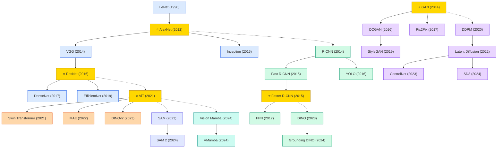

# Computer Vision (CV)

A collection of must-read computer vision papers from top venues.

## Tech Tree

### Paradigm Guide

| Paradigm | Description |
|:---|:---|
|  | CNN backbone architectures for visual feature extraction, from AlexNet's breakthrough to efficient modern designs |
|  | Region-based and single-shot detectors that locate and classify objects in images, from R-CNN to end-to-end DINO |
|  | Attention-based architectures replacing or augmenting CNN feature extraction for visual understanding |
|  | Image synthesis methods from adversarial training (GAN) to controllable diffusion processes (ControlNet, SD3) |
|  | Large-scale pretrained models for versatile visual tasks, from promptable segmentation (SAM) to video understanding |
|  | State space models adapted for vision with linear complexity, offering efficient alternatives to self-attention |
|  | Pioneering works with high impact and citation, foundational to the field |

## Contents

- [Classic Papers](classic.md) — Foundational and pioneering works
- [2024](2024.md)
- [2023](2023.md)
- [2022](2022.md)
- [2021](2021.md)
- [2017](2017.md)
- [2016](2016.md)
