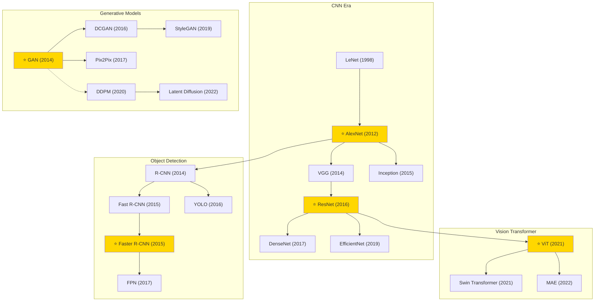

# Computer Vision (CV)

A collection of must-read computer vision papers from top venues.

## Tech Tree

## Contents

- [Classic Papers](classic.md) — Foundational and pioneering works
- [2022](2022.md)
- [2021](2021.md)
- [2017](2017.md)
- [2016](2016.md)
