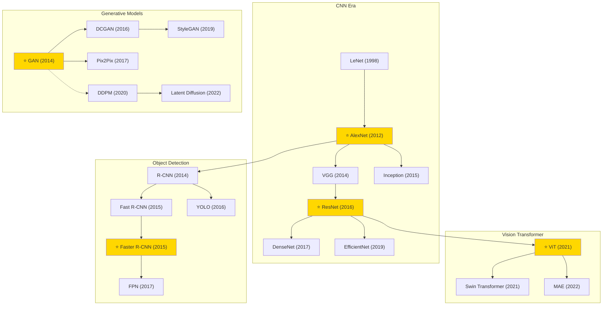

# Computer Vision — Tech Tree

## Key Evolution Paths

| Path | Description |
|------|-------------|
| **Classification** | LeNet → AlexNet → VGG/Inception → ResNet → EfficientNet → ViT |
| **Detection** | R-CNN → Fast/Faster R-CNN → FPN / YOLO series |
| **Vision Transformer** | ViT → Swin Transformer → MAE (self-supervised) |
| **Generation** | GAN → DCGAN → StyleGAN → Diffusion → Latent Diffusion |
