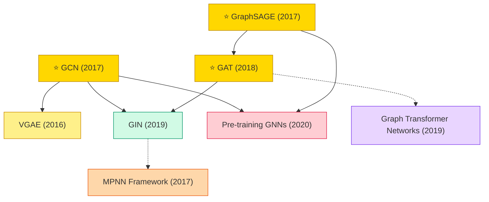

# Graph Learning

A collection of must-read graph learning papers from top venues.

## Tech Tree

### Paradigm Guide

| Paradigm | Description |
|:---|:---|
|  | Graph convolutions defined in the spectral domain via graph Fourier transforms |
|  | Message-passing approaches that aggregate neighbor features directly in graph space |
|  | Theoretical analysis of GNN expressiveness, connections to Weisfeiler-Lehman tests |
|  | Attention-based architectures adapted for graph-structured data |
|  | Self-supervised strategies for learning transferable graph representations |
|  | Variational and generative models for graph structure generation |
|  | Pioneering works with high impact and citation, foundational to the field |

## Contents

- [Classic Papers](classic.md) — Foundational and pioneering works
- [2020](2020.md)
- [2019](2019.md)
- [2016](2016.md)
