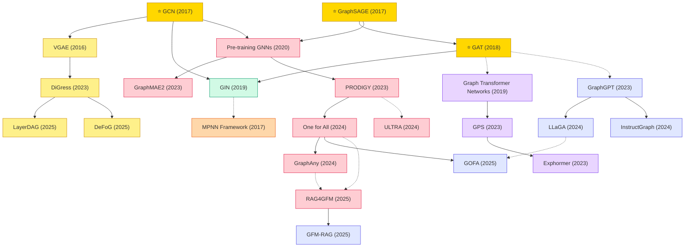

# Graph Learning

A collection of must-read graph learning papers from top venues.

## Tech Tree

### Paradigm Guide

| Paradigm | Description |
|:---|:---|
|  | Graph convolutions defined in the spectral domain via graph Fourier transforms |
|  | Message-passing approaches that aggregate neighbor features directly in graph space |
|  | Theoretical analysis of GNN expressiveness, connections to Weisfeiler-Lehman tests |
|  | Attention-based architectures adapted for graph-structured data, from local+global (GPS) to sparse (Exphormer) |
|  | Self-supervised and foundation model strategies for transferable graph representations across diverse domains |
|  | Variational and diffusion-based generative models for graph structure generation |
|  | Methods integrating large language models with GNNs for text-based graph reasoning and instruction following |
|  | Pioneering works with high impact and citation, foundational to the field |

## Benchmark Datasets

### Node Classification (Citation / Social)

| Dataset | Nodes / Edges | Task | Description |
|:---|:---|:---|:---|
| **Cora** | 2.7k / 5.4k | 7-class | Citation network benchmark introduced by GCN; small-scale semi-supervised classification |
| **Citeseer** | 3.3k / 4.7k | 6-class | Classic citation benchmark alongside Cora |
| **Pubmed** | 19.7k / 44k | 3-class | Diabetes publication citation network |
| **Reddit** | 233k / 11.6M | 41-class | Post-community classification (GraphSAGE benchmark) |
| **Flickr / Yelp / AmazonProducts** | 89k–1.6M | Multi-label | Inductive node classification benchmarks from GraphSAINT |
| **ogbn-arxiv / products / papers100M** | 169k / 2.4M / 111M | Node classification | OGB large-scale citation / co-purchase / academic benchmarks |
| **ogbn-mag / mag240M** | 1.9M / 240M | Heterogeneous | Heterogeneous academic graph (papers/authors/institutions) |

### Link Prediction & Knowledge Graphs

| Dataset | Entities / Relations | Description |
|:---|:---|:---|
| **FB15k-237** | 14.5k / 237 | Filtered Freebase subset; standard KGE benchmark |
| **WN18RR** | 40.9k / 11 | WordNet subset for link prediction |
| **ogbl-ppa / citation2 / collab / ddi** | OGB | Protein-protein / citation / collaboration / drug-drug edge tasks |
| **YAGO3-10 / NELL-995** | — | Additional KG completion benchmarks |

### Graph Classification & Regression

| Dataset | Graphs | Task | Description |
|:---|:---|:---|:---|
| **TUDataset** | 120+ collections | Various | Bioinformatics and social graph benchmarks (MUTAG, PROTEINS, IMDB-B, etc.) |
| **ogbg-molhiv / molpcba** | 41k / 438k molecules | Binary / multi-label | Molecular property prediction (OGB) |
| **ogbg-ppa / ogbg-code2** | 158k / 452k | Multi-class / sequence | Protein associations / code abstract-syntax graphs |
| **ZINC / ZINC-250K** | 12k / 250k molecules | Regression | Constrained solubility regression; canonical graph-regression benchmark |
| **QM9** | 134k molecules | Multi-task regression | Quantum properties of small organic molecules |
| **MoleculeNet** | 17 datasets | Mixed | Drug-discovery benchmark suite |
| **PCQM4Mv2** | 3.8M molecules | DFT energy regression | OGB-LSC graph-regression track |

### Spatio-Temporal Graphs

| Dataset | Nodes | Frequency | Description |
|:---|:---|:---|:---|
| **METR-LA** | 207 sensors | 5min | LA highway speed (DCRNN benchmark) |
| **PEMS-BAY / PEMS03/04/07/08** | 325 / 170–883 | 5min | California traffic flow/speed; standard for STGNN work |

### Graph Foundation Models & Benchmarks

| Dataset | Scale | Description |
|:---|:---|:---|
| **OGB (Open Graph Benchmark)** | 15 datasets | Unified node/link/graph benchmark with standardized splits |
| **OGB-LSC** | 3 datasets | Large-scale challenge track (MAG240M-LSC, WikiKG90Mv2-LSC, PCQM4Mv2-LSC) |
| **PRODIGY Chem/Arxiv** | — | In-context pretraining benchmark used to train PRODIGY |
| **TAG / ULTRA knowledge graphs** | 57 KGs | Multi-source KG mix used to pretrain ULTRA foundation model |
| **One-for-All (OFA) Collection** | 9 text-attributed graphs | Unified text-attributed graph benchmark spanning citation, molecules, KGs |
| **GLBench / GraphArena / TAGLAS** | 30+ datasets | Recent evaluation suites for graph foundation models and LLM+Graph |

## Contents

- [Classic Papers](classic.md) — Foundational and pioneering works
- [2026](2026.md)
- [2025](2025.md)
- [2024](2024.md)
- [2023](2023.md)
- [2020](2020.md)
- [2019](2019.md)
- [2016](2016.md)
