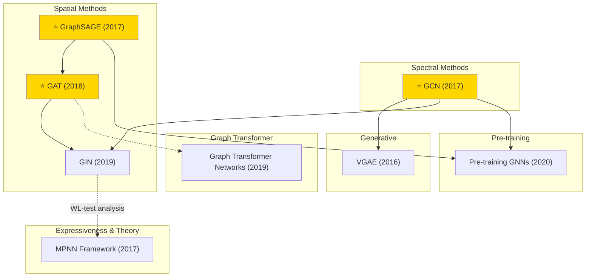

# Graph Learning — Tech Tree

## Key Evolution Paths

| Path | Description |
|------|-------------|
| **Spectral → Spatial** | GCN (spectral convolution) → GraphSAGE (sampling) → GAT (attention) |
| **Expressiveness** | GCN/GraphSAGE → GIN (maximally powerful under WL-test) |
| **Unified Framework** | Various GNNs → MPNN (message passing unification) |
| **Generative** | GCN + VAE → VGAE (link prediction) |
| **Scalability** | GCN → GraphSAGE (inductive, sampling-based) → Pre-training GNNs |
