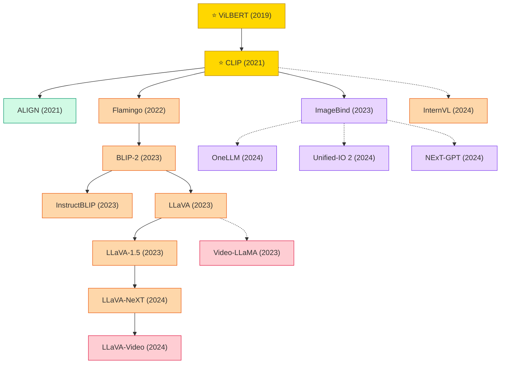

# Multimodal Learning

A collection of must-read multimodal learning papers from top venues.

## Tech Tree

### Paradigm Guide

| Paradigm | Description |
|:---|:---|
|  | First dual-stream architectures jointly modeling vision and language modalities |
|  | Methods aligning image and text representations in a shared embedding space via contrastive objectives |
|  | Large models integrating frozen LLMs with visual encoders, from BLIP-2 to the LLaVA family and InternVL |
|  | Models aligning multiple modalities into a single space, enabling any-to-any generation (NExT-GPT, Unified-IO 2) |
|  | Models extending image-language capabilities to video with temporal reasoning and video instruction following |
|  | Pioneering works with high impact and citation, foundational to the field |

## Contents

- [Classic Papers](classic.md) — Foundational and pioneering works
- [2024](2024.md)
- [2023](2023.md)
- [2022](2022.md)
- [2021](2021.md)
