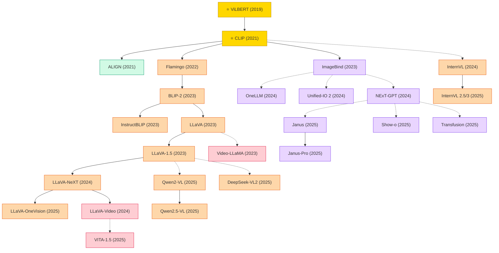

# Multimodal Learning

A collection of must-read multimodal learning papers from top venues.

## Tech Tree

### Paradigm Guide

| Paradigm | Description |
|:---|:---|
|  | First dual-stream architectures jointly modeling vision and language modalities |
|  | Methods aligning image and text representations in a shared embedding space via contrastive objectives |
|  | Large models integrating frozen LLMs with visual encoders, from BLIP-2 to the LLaVA family and InternVL |
|  | Models aligning multiple modalities into a single space, enabling any-to-any generation (NExT-GPT, Unified-IO 2) |
|  | Models extending image-language capabilities to video with temporal reasoning and video instruction following |
|  | Pioneering works with high impact and citation, foundational to the field |

## Benchmark Datasets

### Image-Text Pretraining

| Dataset | Scale | Description |
|:---|:---|:---|
| **Conceptual Captions (CC3M / CC12M)** | 3M / 12M | Alt-text filtered web image-text pairs |
| **SBU Captions** | 1M | Early web-crawled image-caption pairs |
| **YFCC100M** | 100M | Flickr photos with metadata; filtered subsets used by CLIP |
| **WIT** | 37.5M image-text, 108 languages | Wikipedia-based multilingual image-text dataset |
| **LAION-400M / LAION-5B** | 400M / 5.85B | Largest open CLIP-filtered image-text corpus |
| **DataComp-1B** | 1.4B | Curation benchmark subset used for training SoTA CLIPs |
| **COYO-700M** | 747M | Kakao's alt-text image-text pairs |

### Captioning & VQA

| Dataset | Task | Scale | Description |
|:---|:---|:---|:---|
| **COCO Captions** | Captioning | 123k images / 616k captions | 5 captions per image; the captioning benchmark |
| **Flickr30k / Flickr30k Entities** | Captioning / grounding | 31k images | Phrase-level grounding annotations |
| **NoCaps** | Zero-shot captioning | 15k images | Open Images captions with in/near/out-of-domain splits |
| **VQA v2** | Visual QA | 204k images / 1.1M questions | Balanced dataset correcting language-prior bias |
| **GQA** | Compositional VQA | 113k images / 22M questions | Scene-graph-grounded question generation |
| **OK-VQA / A-OKVQA** | Knowledge VQA | 14k / 25k | Questions requiring external commonsense/world knowledge |
| **TextVQA / ST-VQA / DocVQA** | Text-reading VQA | 28k / 23k / 50k | Questions about text within images and documents |
| **ScienceQA** | Multimodal reasoning | 21k questions | Multi-subject scientific MCQA with diagrams |
| **ChartQA / AI2D / InfographicVQA** | Diagram/chart | 9.6k / 5k / 30k | Figure / diagram / infographic understanding |

### Grounding & Referring

| Dataset | Scale | Description |
|:---|:---|:---|
| **RefCOCO / RefCOCO+ / RefCOCOg** | 142k referring expressions | Region-level grounding on COCO images |
| **Visual Genome** | 108k images, 5.4M regions | Dense region descriptions, scene graphs, attributes |
| **GRIT / GrIT-20M** | 20M | Grounded image-text pairs with bounding boxes for Kosmos-2 |

### Multimodal Instruction Tuning

| Dataset | Scale | Description |
|:---|:---|:---|
| **LLaVA-Instruct-150k / LLaVA-665k / LLaVA-1.5-Instruct** | 150k–1.2M | GPT-4 generated instruction-tuning dialogues on COCO images |
| **ShareGPT4V** | 1.2M | Dense captions generated by GPT-4V |
| **M3IT / MIMIC-IT** | 2.4M / 2.8M | Multilingual / in-context multimodal instruction corpora |
| **Cambrian-7M / LLaVA-OneVision-Data** | 7M / 4.7M | Curated large-scale VLM instruction corpora (2024) |

### VLM Benchmarks

| Dataset | Focus | Description |
|:---|:---|:---|
| **MMBench / MMBench-CN** | Comprehensive VLM eval | 3k binary-choice questions with circular evaluation |
| **MME** | Perception + cognition | 14 subtasks with yes/no questions |
| **SEED-Bench / SEED-Bench-2** | Image + video | Multi-choice benchmark across 12–27 dimensions |
| **MMMU / MMMU-Pro** | College-level reasoning | Multimodal MMLU: 11.5k expert-level multi-discipline questions |
| **MathVista / MathVerse** | Math reasoning | Visual mathematical reasoning benchmarks |
| **MMVet / MM-Vet v2** | Open-ended capability | Evaluates 6–8 integrated VL capabilities via LLM judge |
| **POPE / HallusionBench** | Hallucination | Object and attribute hallucination benchmarks |
| **RealWorldQA / BLINK / CV-Bench** | Perception | Visual perception and spatial reasoning evals |
| **Video-MME / MVBench / EgoSchema** | Video LM eval | Comprehensive video-language understanding benchmarks |

### Video-Text

| Dataset | Scale | Description |
|:---|:---|:---|
| **MSR-VTT / MSVD** | 10k / 2k clips | Standard video captioning / video-text retrieval benchmarks |
| **ActivityNet Captions** | 20k videos / 100k captions | Dense temporal video captioning |
| **HowTo100M** | 136M clips | Instructional YouTube videos with narrations |
| **WebVid-2M / 10M** | 2M / 10M | Text-video pairs for pretraining |
| **Panda-70M / HD-VG-130M** | 70M / 130M | Large-scale pretraining corpora for text-to-video and video LLMs |

### Audio/Any-to-Any

| Dataset | Purpose | Description |
|:---|:---|:---|
| **AudioCaps / Clotho** | Audio captioning | Weakly/strongly labeled audio captioning benchmarks |
| **VGG-Sound** | Audio-visual | 200k YouTube clips with 309 audio categories |
| **MMBench-Audio / AIR-Bench** | Audio LLM | Instruction following for audio-language models |

## Contents

- [Classic Papers](classic.md) — Foundational and pioneering works
- [2025](2025.md)
- [2024](2024.md)
- [2023](2023.md)
- [2022](2022.md)
- [2021](2021.md)
