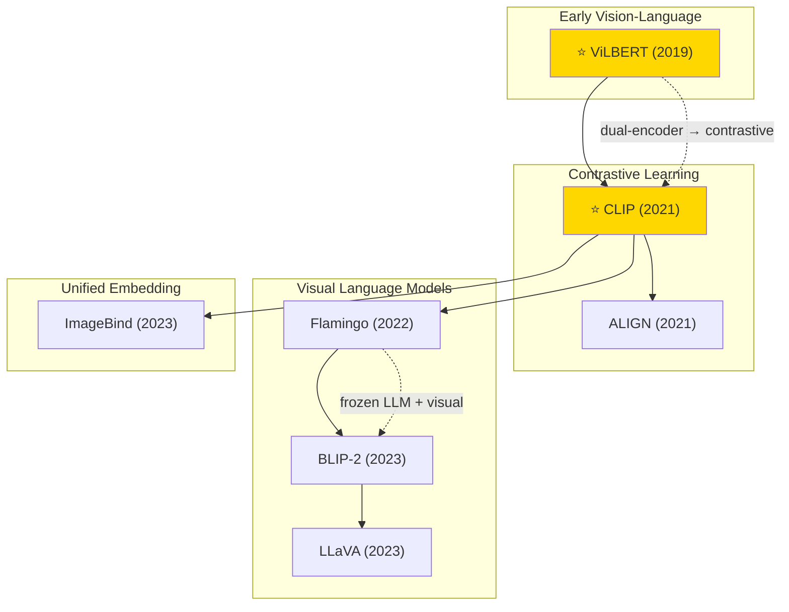

# Multimodal Learning — Tech Tree

## Key Evolution Paths

| Path | Description |
|------|-------------|
| **Vision-Language Pre-training** | ViLBERT (co-attention) → CLIP (contrastive) → ALIGN (noisy data scaling) |
| **Visual LLMs** | Flamingo (gated cross-attention) → BLIP-2 (Q-Former bridge) → LLaVA (instruction tuning) |
| **Unified Multimodal** | CLIP (2 modalities) → ImageBind (6 modalities) |
| **Key Shift** | From task-specific fine-tuning to zero-shot transfer via contrastive pre-training |
