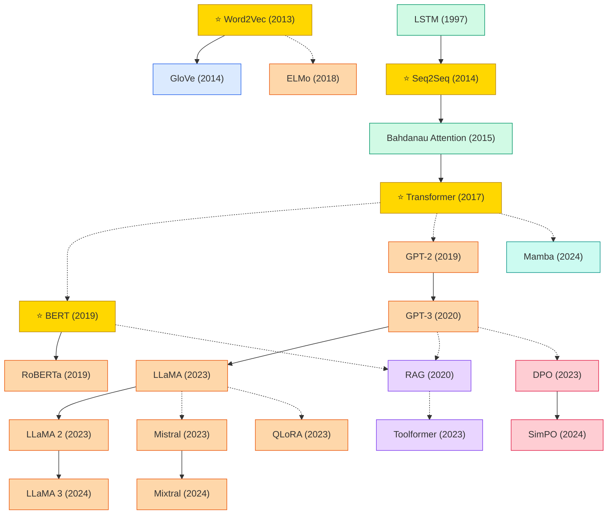

# Natural Language Processing (NLP)

A collection of must-read NLP papers from top venues.

## Tech Tree

### Paradigm Guide

| Paradigm | Description |
|:---|:---|
|  | Static distributed word embeddings that encode semantic relationships in dense vectors |
|  | Architectures for processing variable-length sequences, from RNN to attention mechanisms |
|  | Large-scale models pre-trained on unlabeled text, from BERT to open LLMs (LLaMA, Mistral, Mixtral) |
|  | Methods combining parametric LMs with non-parametric retrieval or tool use for knowledge-grounded generation |
|  | Preference optimization methods aligning LLM outputs with human values, from RLHF to direct preference objectives (DPO) |
|  | State space models with selective mechanisms as linear-complexity alternatives to Transformers for sequence modeling |
|  | Pioneering works with high impact and citation, foundational to the field |

## Benchmark Datasets

### Pretraining Corpora

| Dataset | Scale | Description |
|:---|:---|:---|
| **Wikipedia + BookCorpus** | ~16GB | Original BERT pretraining corpus |
| **C4 (Colossal Clean Crawled Corpus)** | 750GB | Cleaned Common Crawl; T5 pretraining corpus |
| **The Pile** | 825GB, 22 sources | EleutherAI's open pretraining corpus (GPT-Neo, GPT-J, Pythia) |
| **RedPajama / RedPajama-v2** | 1.2T / 30T tokens | Open reproduction of the LLaMA data mixture |
| **RefinedWeb** | 5T tokens | Falcon's web-only pretraining corpus |
| **Dolma** | 3T tokens | AllenAI's open pretraining corpus for OLMo |
| **SlimPajama** | 627B tokens | Deduplicated/cleaned RedPajama |
| **FineWeb / FineWeb-Edu** | 15T / 1.3T tokens | HuggingFace's quality-filtered web corpus (2024) |

### Classification & Understanding Benchmarks

| Dataset | Tasks | Description |
|:---|:---|:---|
| **GLUE** | 9 tasks | General Language Understanding Evaluation (CoLA, SST-2, MRPC, STS-B, QQP, MNLI, QNLI, RTE, WNLI) |
| **SuperGLUE** | 8 tasks | Harder successor to GLUE (BoolQ, CB, COPA, MultiRC, ReCoRD, RTE, WiC, WSC) |
| **XTREME / XTREME-R** | 40 languages, 9 tasks | Cross-lingual transfer evaluation benchmark |
| **SQuAD 1.1 / 2.0** | 100k / 150k QA pairs | Reading comprehension over Wikipedia passages |
| **CoNLL-2003** | NER | Standard English named-entity recognition benchmark |

### LLM Evaluation Suites

| Dataset | Scale | Description |
|:---|:---|:---|
| **MMLU** | 15,908 questions, 57 subjects | Multitask knowledge benchmark across STEM, humanities, law, medicine |
| **MMLU-Pro** | 12k questions | Harder version with 10 answer options and reasoning-heavy items |
| **BIG-Bench / BBH** | 204 / 23 tasks | Beyond the Imitation Game benchmark and its hard 23-task subset |
| **HellaSwag** | 70k | Commonsense sentence completion; adversarial filtering |
| **ARC (Easy / Challenge)** | 7,787 | Grade-school science QA benchmark |
| **TruthfulQA** | 817 questions | Measures tendency to reproduce common falsehoods |
| **GSM8K** | 8,500 | Grade-school word-problem math benchmark |
| **MATH** | 12,500 | Competition-level mathematics problems |
| **HumanEval / MBPP** | 164 / 974 | Python code synthesis benchmarks |
| **IFEval** | 541 prompts | Instruction-following evaluation with verifiable constraints |
| **AlpacaEval / MT-Bench / Arena-Hard** | open-ended | LLM-as-judge chatbot quality benchmarks |

### Instruction Tuning & Alignment

| Dataset | Scale | Description |
|:---|:---|:---|
| **Alpaca / Alpaca-GPT4** | 52k | Self-Instruct style instructions generated from GPT-3.5/4 |
| **Dolly-15k** | 15k | Human-written instruction-response pairs (Databricks) |
| **LIMA** | 1k | Carefully curated high-quality instructions (Meta) |
| **ShareGPT** | ~90k conversations | Real user-ChatGPT dialogues; powers Vicuna |
| **OpenOrca / SlimOrca** | 4.2M / 518k | GPT-4 traced CoT completions of FLAN prompts |
| **Anthropic HH-RLHF** | 169k pairs | Helpfulness and harmlessness preference data |
| **UltraFeedback** | 64k prompts | Multi-LLM response preference dataset for DPO |
| **Nectar** | 183k pairs | 7-way ranked comparison preference dataset |

### Classical NLP Tasks

| Dataset | Task | Description |
|:---|:---|:---|
| **WMT (14/16/19/...)** | Machine translation | Annual shared-task parallel corpora (EN-DE, EN-FR, EN-ZH, etc.) |
| **CNN/DailyMail / XSum** | Summarization | News article summarization with extractive / abstractive flavors |
| **MultiWOZ** | Dialogue | Multi-domain task-oriented dialogue benchmark |
| **LAMBADA** | Long-range LM | Last-word prediction requiring broad context |

## Contents

- [Classic Papers](classic.md) — Foundational and pioneering works
- [2026](2026.md)
- [2025](2025.md)
- [2024](2024.md)
- [2023](2023.md)
- [2020](2020.md)
- [2019](2019.md)
- [2014](2014.md)
