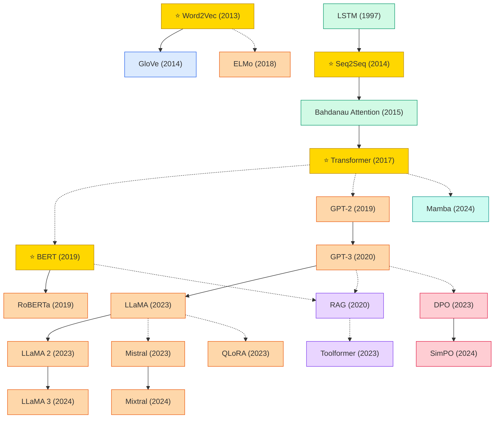

# Natural Language Processing (NLP)

A collection of must-read NLP papers from top venues.

## Tech Tree

### Paradigm Guide

| Paradigm | Description |
|:---|:---|
|  | Static distributed word embeddings that encode semantic relationships in dense vectors |
|  | Architectures for processing variable-length sequences, from RNN to attention mechanisms |
|  | Large-scale models pre-trained on unlabeled text, from BERT to open LLMs (LLaMA, Mistral, Mixtral) |
|  | Methods combining parametric LMs with non-parametric retrieval or tool use for knowledge-grounded generation |
|  | Preference optimization methods aligning LLM outputs with human values, from RLHF to direct preference objectives (DPO) |
|  | State space models with selective mechanisms as linear-complexity alternatives to Transformers for sequence modeling |
|  | Pioneering works with high impact and citation, foundational to the field |

## Contents

- [Classic Papers](classic.md) — Foundational and pioneering works
- [2024](2024.md)
- [2023](2023.md)
- [2020](2020.md)
- [2019](2019.md)
- [2014](2014.md)
