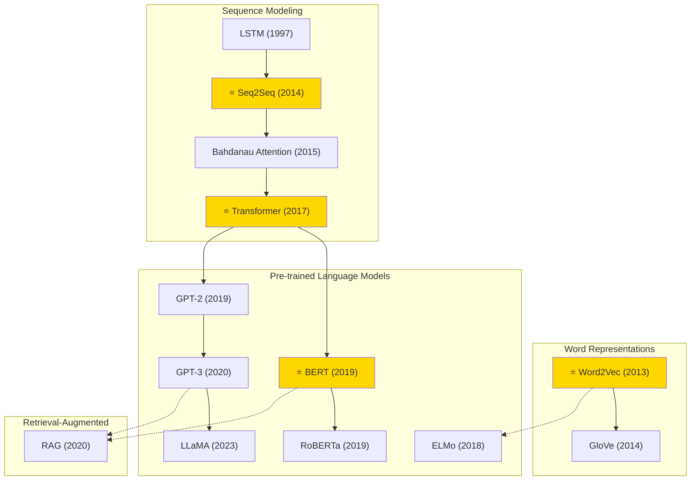

# Natural Language Processing (NLP)

A collection of must-read NLP papers from top venues.

## Tech Tree

## Contents

- [Classic Papers](classic.md) — Foundational and pioneering works
- [2023](2023.md)
- [2020](2020.md)
- [2019](2019.md)
- [2014](2014.md)
