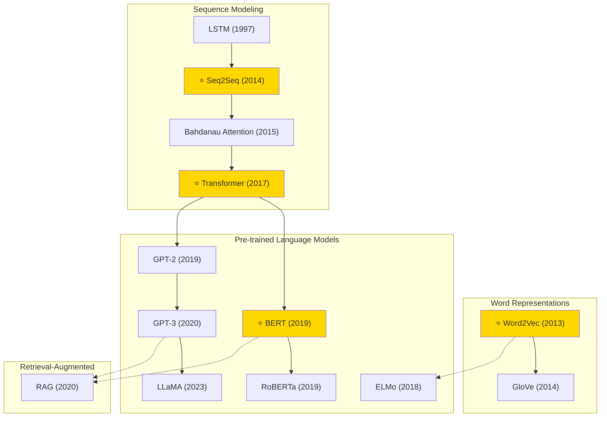

# Natural Language Processing — Tech Tree

## Key Evolution Paths

| Path | Description |
|------|-------------|
| **Representations** | Word2Vec → GloVe → ELMo → BERT (contextualized) |
| **Seq2Seq** | LSTM → Seq2Seq → Attention → Transformer |
| **Autoregressive LM** | GPT-2 → GPT-3 → LLaMA (open-source) |
| **Bidirectional LM** | BERT → RoBERTa (optimized pre-training) |
| **Knowledge-Augmented** | LLM + Retrieval → RAG |
