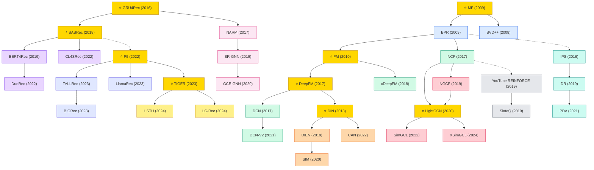

# Recommendation Systems

A collection of must-read recommendation system papers from top venues (SIGIR, RecSys, KDD, WWW, NeurIPS, ICML, ICLR, CIKM, AAAI, IJCAI, ACL, TOIS). Organized into 10 paradigm subdirectories covering collaborative filtering, deep learning, CTR prediction, sequential methods, session-based recommendation, graph neural networks, LLM-based approaches, generative models, debiasing/fairness, and reinforcement learning.

## Tech Tree

### Paradigm Guide

| Paradigm | Description |
|:---|:---|
|  | Collaborative filtering and matrix factorization — the foundational paradigm |
|  | Deep neural architectures for feature interaction learning |
|  | Click-through rate prediction and industrial ranking systems |
|  | Modeling long-term user behavior sequences |
|  | Short anonymous session-based recommendation |
|  | GNN-based recommendation via user-item interaction graphs |
|  | Large language models applied to recommendation |
|  | Generative retrieval, semantic IDs, and generative recommenders |
|  | Bias correction, fairness, and causal inference for recommendation |
|  | Reinforcement learning for long-term user value optimization |
|  | Pioneering works with high impact, foundational to the field |

## Benchmark Datasets

### General / Academic

| Dataset | Users / Items / Interactions | Description |
|:---|:---|:---|
| **MovieLens (100K / 1M / 10M / 20M / 25M)** | varying | De facto academic benchmark for CF, sequential, and graph methods |
| **Amazon Reviews (Beauty / Sports / Toys / Books / Clothing)** | varying | Large-scale review datasets; standard for sequential and LLM4Rec |
| **Yelp** | ~1.9M / 150K / 8M+ | User reviews of businesses; popular for graph-based methods |
| **Gowalla** | 30K / 41K / 1M | Location check-in graph; LightGCN-era benchmark |
| **Last.FM** | 2K / 18K / 93K | Music listening; HetRec and social rec benchmark |
| **Book-Crossing** | 280K / 271K / 1.1M | Book rating network |

### CTR / Industrial Advertising

| Dataset | Scale | Description |
|:---|:---|:---|
| **Criteo** | 45M ads | Standard CTR benchmark for feature-interaction models |
| **Avazu** | 40M impressions | Mobile ad click prediction |
| **iPinYou** | 19.5M bids | RTB click + conversion |
| **KuaiRand / KuaiSAR** | — | Kuaishou short-video click and search+recommend dataset with unbiased evaluation |

### Industrial / Large-Scale

| Dataset | Description |
|:---|:---|
| **Taobao User Behavior** | 100M interactions for CTR / sequential rec |
| **Alibaba Ads** | Production ad dataset released with DIN/DIEN papers |
| **Tenrec** | 5M users / 140M interactions; Tencent benchmark for 10+ tasks |

### Sequential / Session

| Dataset | Description |
|:---|:---|
| **Diginetica** | E-commerce session clicks; RecSys 2016 Challenge |
| **YooChoose** | E-commerce session clicks; RecSys 2015 Challenge |
| **RetailRocket** | E-commerce session/transaction |

### News & Text-Attributed

| Dataset | Description |
|:---|:---|
| **MIND (small / large)** | Microsoft news recommendation with article text |
| **Adressa** | Norwegian news click stream |

## Evaluation Metrics

| Metric | Used For | Definition |
|:---|:---|:---|
| **HR@K** | Top-K | Hit rate at K |
| **NDCG@K** | Top-K | Normalized discounted cumulative gain at K |
| **Recall@K** | Top-K | Recall among top K |
| **MRR** | Top-K | Mean reciprocal rank |
| **AUC / GAUC** | CTR | Area under ROC / group-weighted AUC |
| **Coverage / Diversity / Novelty / Serendipity** | Top-K | Beyond-accuracy metrics |

## Contents

- [Collaborative Filtering & Matrix Factorization](cf-mf/)
- [Deep Recommenders](deep-rec/)
- [CTR Prediction & Ranking](ctr-ranking/)
- [Sequential Recommendation](sequential-rec/)
- [Session-based Recommendation](session-rec/)
- [Graph-based Recommendation](graph-rec/)
- [LLM for Recommendation](llm4rec/)
- [Generative Recommendation](generative-rec/)
- [Debiasing / Fairness / Causal](debias-causal/)
- [Reinforcement Learning for Recommendation](rl-rec/)
