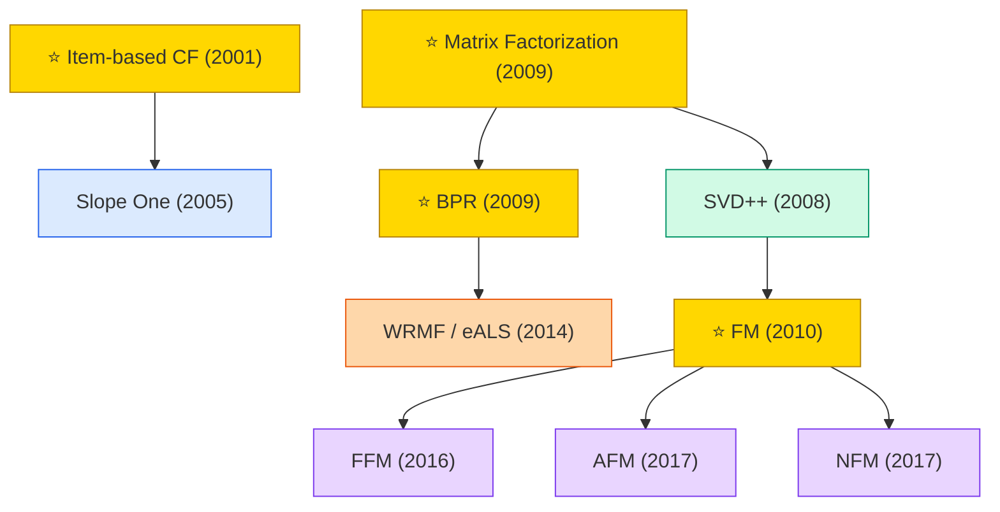

# Collaborative Filtering & Matrix Factorization

The foundational paradigm of recommendation systems. Models user-item interactions via latent-factor decomposition or neighborhood methods.

## Tech Tree

### Paradigm Legend

| Color | Meaning |
|:---|:---|
|  | Item/user-based CF with similarity heuristics |
|  | SVD, SVD++, biased MF — low-rank decomposition of rating matrix |
|  | BPR, WRMF, eALS — optimize ranking losses for implicit feedback |
|  | FM family — generalizes MF to arbitrary feature interactions |
|  | Pioneering works |

## Contents

- [Classic Papers](classic.md) — 1994–2015 foundational works
- [2017](2017.md)
- [2018](2018.md)
- [2019](2019.md)
- [misc](misc.md) — sparse years combined
