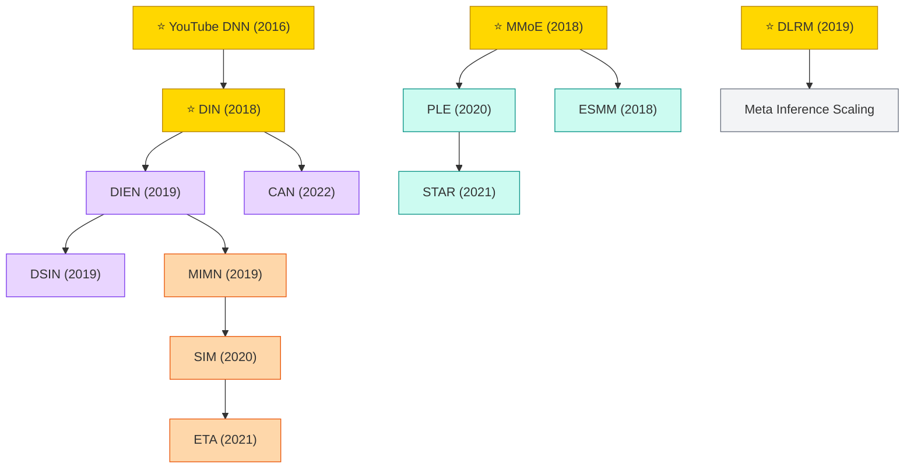

# CTR Prediction & Ranking

CTR prediction and industrial ranking systems, emphasizing user-interest modeling, multi-task learning, and long-sequence modeling for production-scale recommender systems.

## Tech Tree

### Paradigm Legend

| Color | Meaning |
|:---|:---|
|  | User interest modeling (DIN, DIEN, DSIN) |
|  | Multi-task / gate architectures (MMoE, PLE, ESMM) |
|  | Long sequence behavior modeling (MIMN, SIM, ETA) |
|  | Production-scale systems (YouTube DNN, DLRM) |
|  | Pioneering works |

## Contents

- [Classic Papers](classic.md) — 2016–2018 foundational works
- [2019](2019.md)
- [2020](2020.md)
- [2021](2021.md)
- [2022](2022.md)
- [2023](2023.md)
- [2024](2024.md)
- [2025](2025.md)
