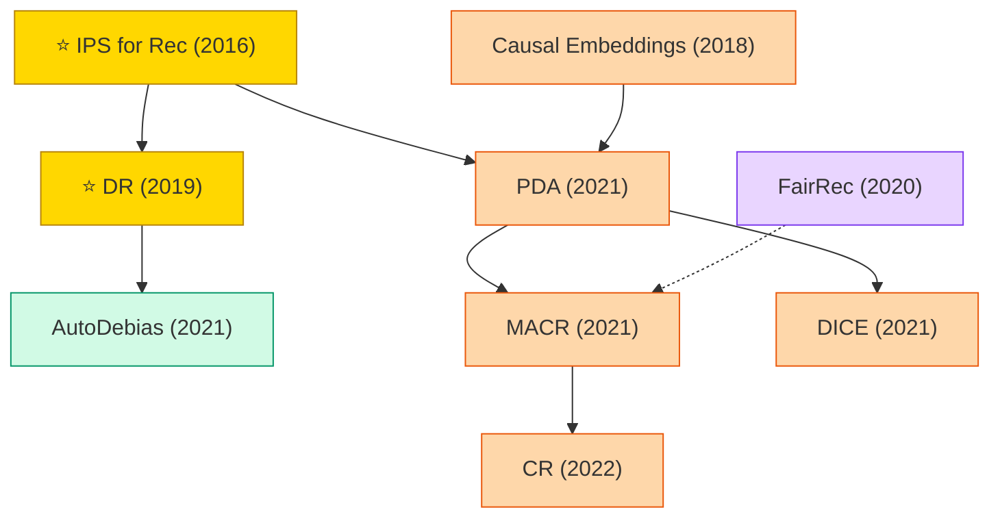

# Debiasing / Fairness / Causal Recommendation

Recommendation data is subject to popularity bias, exposure bias, selection bias, and conformity bias. This paradigm applies causal inference tools (IPS, DR, counterfactuals) to debias.

## Tech Tree

### Paradigm Legend

| Color | Meaning |
|:---|:---|
|  | IPS / propensity-weighted debiasing |
|  | DR family combining IPS and direct estimation |
|  | Counterfactual / causal embeddings approaches |
|  | Fair recommendation for providers and users |
|  | Pioneering works |

## Contents

- [Classic Papers](classic.md) — 2015–2018 foundational works
- [2019](2019.md)
- [2020](2020.md)
- [2021](2021.md)
- [2022](2022.md)
