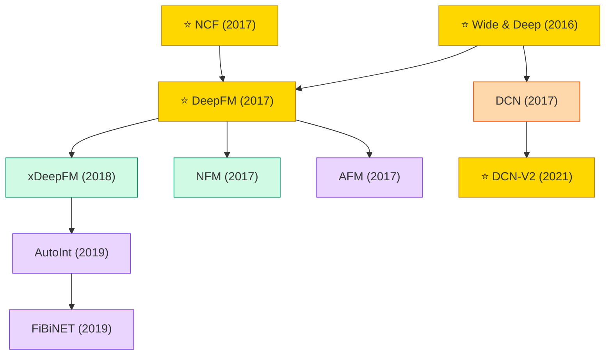

# Deep Recommenders

Deep feature-interaction models. Build on FM by replacing shallow second-order interactions with deep networks for CTR and ranking.

## Tech Tree

### Paradigm Legend

| Color | Meaning |
|:---|:---|
|  | Memorization + generalization hybrids |
|  | Deep FM extensions (DeepFM, NFM, xDeepFM) |
|  | Explicit feature crossing (DCN, DCN-V2) |
|  | Attention over feature interactions (AFM, AutoInt, FiBiNET) |
|  | Pioneering works |

## Contents

- [Classic Papers](classic.md) — 2016–2017 foundational works
- [2018](2018.md)
- [2019](2019.md)
- [2021](2021.md)
