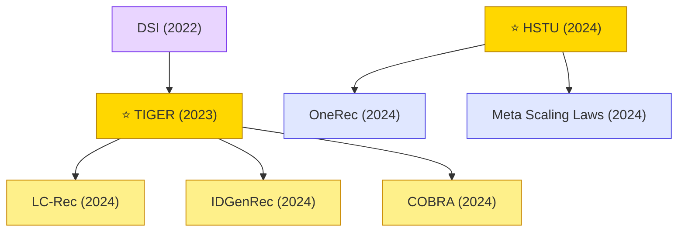

# Generative Recommendation

Generative recommendation treats recommendation as sequence generation: predict item IDs (or semantic codes) auto-regressively. Enables foundation-model-style scaling.

## Tech Tree

### Paradigm Legend

| Color | Meaning |
|:---|:---|
|  | RQ-VAE / semantic-code based item representations |
|  | Generative retrieval paradigm from IR (DSI, TIGER) |
|  | Foundation-model scaling for recommendation (HSTU, OneRec) |
|  | Pioneering works |

## Contents

- [Classic Papers](classic.md) — 2022–2023 paradigm launch works
- [2022](2022.md)
- [2023](2023.md)
- [2024](2024.md)
