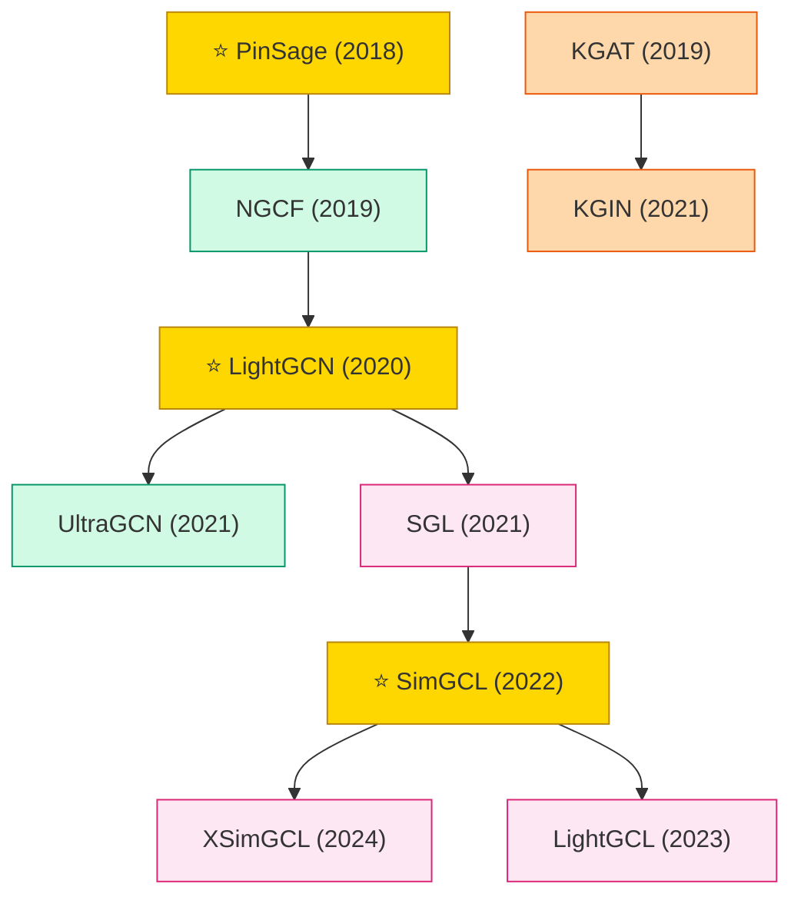

# Graph-based Recommendation

GNN-based recommendation on user-item interaction graphs. Evolved from heavy-weight message passing (PinSage, NGCF) to minimalist (LightGCN) to contrastive methods (SimGCL).

## Tech Tree

### Paradigm Legend

| Color | Meaning |
|:---|:---|
|  | Graph convolution based CF (NGCF, LightGCN, UltraGCN) |
|  | Graph contrastive learning for recommendation (SGL, SimGCL) |
|  | Knowledge-graph aware recommendation (KGAT, KGIN) |
|  | Hyperedge modeling over user-item structures |
|  | Pioneering works |

## Contents

- [Classic Papers](classic.md) — 2018–2019 launch era works
- [2019](2019.md)
- [2020](2020.md)
- [2021](2021.md)
- [2022](2022.md)
- [2023](2023.md)
- [2024](2024.md)
