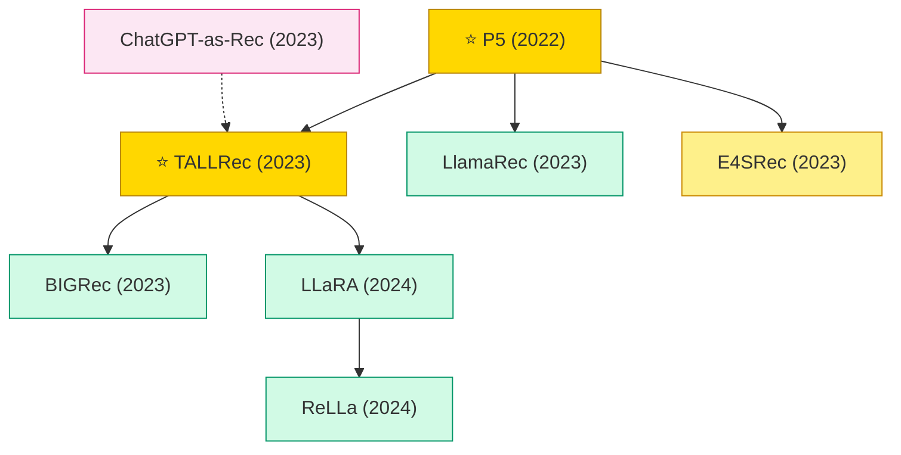

# LLM for Recommendation

LLMs applied to recommendation, either as zero/few-shot recommenders or fine-tuned for instruction-following over recommendation tasks. Paradigm began in 2022 with P5.

## Tech Tree

### Paradigm Legend

| Color | Meaning |
|:---|:---|
|  | P5-style multi-task prompting for recommendation |
|  | LoRA / fine-tuned LLMs for recommendation tasks |
|  | ChatGPT/GPT-4 as recommender with no fine-tuning |
|  | LLM embeddings injected into existing rec models |
|  | Pioneering works |

## Contents

- [Classic Papers](classic.md) — 2022–2023 paradigm launch works
- [2022](2022.md)
- [2023](2023.md)
- [2024](2024.md)
