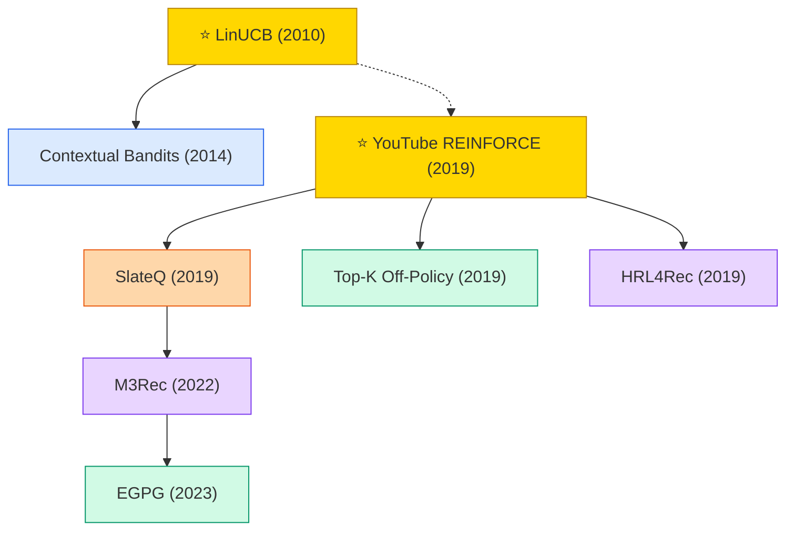

# Reinforcement Learning for Recommendation

RL for recommendation optimizes long-term user engagement/retention rather than single-step click. Off-policy correction (YouTube REINFORCE) and slate actions (SlateQ) are core challenges.

## Tech Tree

### Paradigm Legend

| Color | Meaning |
|:---|:---|
|  | Contextual bandit methods (LinUCB, Thompson Sampling) |
|  | Policy-gradient / REINFORCE-based methods |
|  | Q-learning / SlateQ for combinatorial action spaces |
|  | HRL / multi-level policy for recommendation |
|  | Pioneering works |

## Contents

- [Classic Papers](classic.md) — Bandit foundations
- [2019](2019.md)
- [2020](2020.md)
- [2021](2021.md)
- [2022](2022.md)
- [2023](2023.md)
- [2024](2024.md)
- [2025](2025.md)
