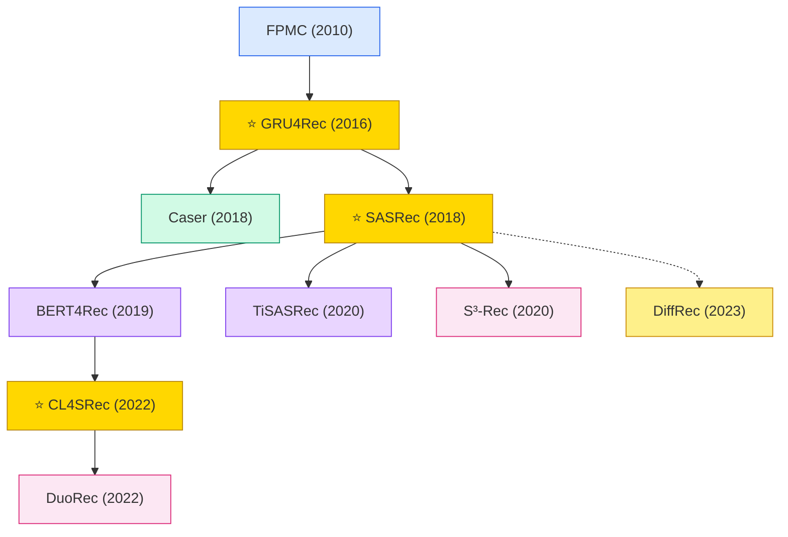

# Sequential Recommendation

Sequential recommendation models the user's full interaction history to predict the next item. Evolved from Markov chains (FPMC) → RNN (GRU4Rec) → Transformer (SASRec, BERT4Rec) → self-supervised and contrastive methods.

## Tech Tree

### Paradigm Legend

| Color | Meaning |
|:---|:---|
|  | RNN/GRU-based sequential models (GRU4Rec, FPMC) |
|  | Convolutional sequential models (Caser) |
|  | Attention-based sequential models (SASRec, BERT4Rec) |
|  | Self-supervised / contrastive learning (CL4SRec, DuoRec) |
|  | Diffusion-based sequential models (DiffRec) |
|  | Pioneering works |

## Contents

- [Classic Papers](classic.md) — Pre-deep foundational works
- [2016](2016.md)
- [2018](2018.md)
- [2019](2019.md)
- [2020](2020.md)
- [2022](2022.md)
- [2023](2023.md)
