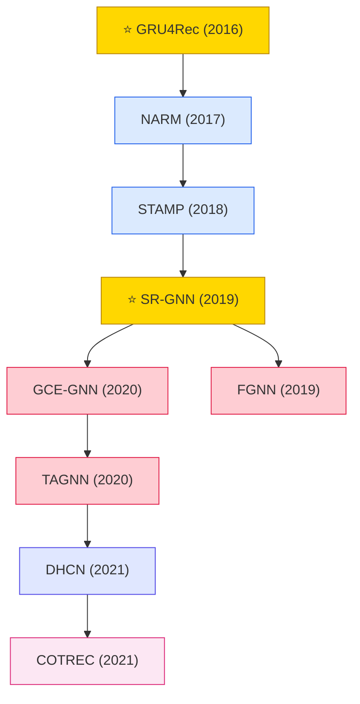

# Session-based Recommendation

Session-based recommendation works on short anonymous sessions (no user ID). Evolved from attention-based (NARM, STAMP) to graph-based (SR-GNN) to hypergraph and contrastive methods.

## Tech Tree

### Paradigm Legend

| Color | Meaning |
|:---|:---|
|  | RNN + attention over session items (NARM, STAMP) |
|  | Graph neural networks on session graphs (SR-GNN, FGNN) |
|  | Hyperedge modeling for session data (DHCN) |
|  | Contrastive session learning (COTREC) |
|  | Pioneering works |

## Contents

- [Classic Papers](classic.md) — 2016–2017 launch era works
- [2018](2018.md)
- [2019](2019.md)
- [2020](2020.md)
- [2021](2021.md)
