# Deep Learning for Signal Processing

A collection of must-read papers at the intersection of deep learning and signal processing, organized by **signal type**. Speech/audio has its own domain and is not included here.

## Subdomains

| Subdomain | Scope |
|:---|:---|
| [**Wireless & Communication Signals**](wireless-comm/) | Physical-layer autoencoders, modulation recognition, channel estimation, CSI feedback, MIMO detection, semantic / joint source-channel coding |
| [**Radar & Remote Sensing**](radar-remote-sensing/) | SAR automatic target recognition, remote-sensing scene classification, DOA estimation, multi-modal (optical + SAR + multispectral) foundation models |
| [**Biomedical Signals**](biomedical/) | EEG-based BCI, ECG arrhythmia diagnosis, wearable biosignals (PPG), large-scale biosignal foundation models |
| [**Image & Video Signal Processing**](image-video/) | Compressive-sensing image recovery, MRI/CT reconstruction, diffusion-based solvers for general noisy inverse problems (overlaps with CV) |
| [**Mechanical Fault Diagnosis**](mechanical-fault-diagnosis/) | Vibration-signal-based rotating-machinery fault diagnosis: bearing / gearbox classification, cross-working-condition transfer, GNN-based methods |
| [**General Methods**](general-methods/) | Cross-signal paradigms: algorithm unrolling, complex-valued networks, neural operators |

## Tech Tree

```mermaid
graph TD
    classDef unroll fill:#DBEAFE,stroke:#2563EB
    classDef comm fill:#D1FAE5,stroke:#059669
    classDef radar fill:#FED7AA,stroke:#EA580C
    classDef bio fill:#E9D5FF,stroke:#7C3AED
    classDef cs fill:#FECDD3,stroke:#E11D48
    classDef cv fill:#FEF08A,stroke:#CA8A04
    classDef fm fill:#E0E7FF,stroke:#4F46E5
    classDef nop fill:#CCFBF1,stroke:#0D9488
    classDef mech fill:#FBCFE8,stroke:#DB2777
    classDef star fill:#FFD700,stroke:#B8860B

    LISTA["⭐ LISTA (2010)"]:::star --> DeepUnfolding["Deep Unfolding (2014)"]:::unroll
    DeepUnfolding --> ADMMNet["ADMM-Net (2016)"]:::unroll
    LISTA --> AMP["Learned AMP (2017)"]:::unroll
    LISTA --> ISTANet["ISTA-Net (2018)"]:::unroll
    ADMMNet --> DetNet["DetNet (2019)"]:::unroll
    ISTANet --> OAMPNet["OAMP-Net (2020)"]:::unroll
    DetNet -.-> OAMPNet
    DeepUnfolding --> AlgUnrollSurvey["Alg. Unrolling Survey (2021)"]:::unroll
    OAMPNet --> NFUnfold["NF Unfolding (2022)"]:::unroll
    AlgUnrollSurvey --> ModelBasedDL["Model-Based DL (2023)"]:::unroll

    ModRec["⭐ Mod. Recognition (2016)"]:::star --> RadioML["RadioML Dataset (2016)"]:::comm
    ModRec --> OTA["OTA Classification (2018)"]:::comm
    Autoencoder["⭐ DL Physical Layer (2017)"]:::star --> OTAComm["DL Over the Air (2018)"]:::comm
    Autoencoder --> OFDM["DL for OFDM (2018)"]:::comm
    Autoencoder --> CsiNet["CsiNet (2018)"]:::comm
    Autoencoder --> DJSCC["Deep JSCC (2019)"]:::comm
    OFDM --> ChannelEst["DL Channel Est. (2019)"]:::comm
    DJSCC --> NTSCC["NTSCC (2022)"]:::comm
    Autoencoder --> BeyondBits["Beyond Bits (2023)"]:::comm

    SAR["SAR-ATR CNN (2016)"]:::radar --> RESISC45["NWPU-RESISC45 (2017)"]:::radar
    SAR --> DeepMUSIC["DeepMUSIC (2020)"]:::radar
    RESISC45 --> RadarSurvey["Radar DL Survey (2021)"]:::radar
    RESISC45 -.-> SatMAE["SatMAE (2022)"]:::fm
    SatMAE --> RingMo["RingMo (2023)"]:::fm
    SatMAE --> SpectralGPT["SpectralGPT (2024)"]:::fm
    SatMAE --> SkySense["SkySense (2024)"]:::fm
    SAR -.-> SARATRX["SARATR-X (2025)"]:::fm

    EEGDecode["EEG Decoding (2017)"]:::bio --> EEGNet["⭐ EEGNet (2018)"]:::star
    ECG["ECG Nature Med (2019)"]:::bio --> ECG12Lead["12-Lead ECG DNN (2020)"]:::bio
    EEGNet -.-> BrainBERT["BrainBERT (2023)"]:::fm
    BrainBERT --> LaBraM["LaBraM (2024)"]:::fm
    LaBraM --> NeuroLM["NeuroLM (2025)"]:::fm
    LaBraM --> CBraMod["CBraMod (2025)"]:::fm
    ECG12Lead -.-> WearableFM["Wearable FM (2024)"]:::fm

    LISTA -.-> CSGen["CS Generative (2017)"]:::cs
    CSGen --> LDAMP["Learned D-AMP (2017)"]:::cs
    CSGen --> DeepCS["Deep CS (2019)"]:::cs
    ADMMNet -.-> ISTANet
    CSGen -.-> ScoreIP["Score-Based IP (2022)"]:::cs
    ScoreIP --> DPS["DPS (2023)"]:::cs
    ScoreIP --> AmbientDiff["Ambient Diffusion (2023)"]:::cs
    DPS --> ReSample["ReSample (2024)"]:::cs
    DPS --> DiffStateGrad["DiffStateGrad (2025)"]:::cs
    DeepCS -.-> IDM["IDM (2025)"]:::cs

    uRNN["Unitary RNN (2016)"]:::cv --> DCN["⭐ Deep Complex Nets (2018)"]:::star

    FNO["FNO (2021)"]:::nop --> SCFNO["SC-FNO (2025)"]:::nop

    JiaDNN["⭐ Jia DNN (2016)"]:::star --> Janssens["Janssens CNN (2016)"]:::mech
    JiaDNN --> WDCNN["WDCNN (2017)"]:::mech
    JiaDNN --> LuDA["Lu Domain Adapt. (2017)"]:::mech
    WDCNN --> WenCNN["Wen 2D-CNN (2018)"]:::mech
    WenCNN --> ZhaoPHM["Zhao PHM Survey (2019)"]:::mech
    ZhaoPHM --> LeiRoadmap["⭐ Lei Roadmap (2020)"]:::star
    LuDA --> ZhaoDTL["Zhao DTL Survey (2021)"]:::mech
    LeiRoadmap --> MRFGCN["MRF-GCN (2021)"]:::mech
```

### Paradigm Guide

| Paradigm | Description |
|:---|:---|
|  | Deep networks derived by unrolling iterative optimization algorithms (ISTA, ADMM, AMP), combining interpretability of model-based methods with trainability of neural networks |
|  | Deep learning for physical-layer problems: autoencoder-based transceivers, modulation recognition, channel estimation, CSI feedback, semantic communications |
|  | CNNs and foundation models for SAR automatic target recognition, remote sensing scene classification, and direction-of-arrival estimation |
|  | Deep learning for EEG-based brain-computer interfaces, ECG arrhythmia classification, and physiological signal decoding |
|  | Learned measurement and reconstruction for compressive sensing and inverse problems, from generative priors to diffusion-based solvers |
|  | Neural networks that natively handle complex-valued data (I/Q signals, Fourier coefficients) via complex convolutions and unitary recurrence |
|  | Large-scale pre-trained models for signal domains — remote sensing imagery, EEG/ECG biosignals — enabling transfer learning and few-shot generalization |
|  | Learning mappings between function spaces (Fourier Neural Operator and extensions) for fast PDE solving and physics-informed signal processing |
|  | Deep learning for rotating-machinery fault diagnosis from vibration signals: bearing / gearbox classification, domain adaptation across working conditions, GNN-based diagnosis |
|  | Pioneering works with high impact and citation, foundational to the field |

## Timeline Highlights

- **2025** — **EEG 基座模型规模化 · 扩散求解器改进 · SAR 基座模型**
  EEG 基座模型全面进入大规模多任务时代——NeuroLM（1.7B 参数，25K 小时 EEG）用 LLM 框架统一六项 BCI 任务，CBraMod 以交叉 Transformer 在 12 个数据集 10 项任务上达到 SOTA；扩散逆问题方法持续演进（DiffStateGrad 低秩投影、IDM 可逆扩散实现 93.8% 内存节省）；SARATR-X 成为首个 SAR 目标识别基座模型；SC-FNO 将敏感性约束引入神经算子。

- **2024** — **信号处理基座模型元年 · 遥感多模态 · 扩散求解逆问题**
  基座模型全面进入信号处理各子领域——LaBraM 成为首个大规模 EEG 基座模型（ICLR Spotlight），Apple 可穿戴生物信号基座模型首次在 14 万人数据上预训练；遥感方向 SpectralGPT 和 SkySense 分别从光谱和多模态（光学+SAR）构建基座模型；ReSample 用潜在扩散模型求解一般逆问题。

- **2023** — **扩散模型入侵逆问题 · 语义通信体系化 · 脑信号预训练 · 遥感基座模型**
  DPS 将扩散模型扩展到一般含噪非线性逆问题成为领域标杆，Ambient Diffusion 首次从不完整数据学习干净分布；Model-Based DL 在 Proc. IEEE 发表成为模型驱动深度学习权威综述；语义通信方向系统化（Beyond Transmitting Bits）；BrainBERT 将 BERT 预训练引入脑电信号；RingMo 建立遥感基座模型。

- **2022** — **Score-based 逆问题 · 语义联合编码 · 遥感预训练 · 流模型展开**
  Score-based 生成模型作为学习先验用于医学影像逆问题，SatMAE 将掩码自编码器预训练扩展到多光谱时序卫星图像，NTSCC 引入非线性变换语义先验推进联合信源信道编码，归一化流模型嵌入算法展开框架。

- **2021** — **Algorithm Unrolling 综述 · 雷达深度学习综述 · 神经算子奠基**
  Algorithm Unrolling 综述在 IEEE SPM 正式发表，系统建立迭代优化算法与深度网络之间的桥梁；雷达深度学习综述全面覆盖波形设计、ATR、干扰抑制等方向；FNO 提出傅里叶域参数化实现函数空间映射学习，比 PDE 求解器快 1000 倍。

- **2020** — **模型驱动检测 · DOA 估计 · 临床心电图**
  OAMP-Net 将正交 AMP 展开为可训练网络用于 MIMO 检测与联合信道估计，DeepMUSIC 用多 CNN 实现多源 DOA 估计，12 导联心电图 DNN 在临床数据上超越住院医师。

- **2019** — **Deep JSCC · DetNet · 压缩感知 · ECG 临床验证**
  Deep JSCC 绕过分离定理用 CNN 直接映射图像到信道符号，DetNet 将投影梯度下降展开为 MIMO 检测网络，Deep Compressed Sensing 联合训练测量与重建，ECG 深度网络在 Nature Medicine 验证超越心脏科医生。

- **2018** — **端到端无线通信 · OFDM · CSI 反馈 · ISTA-Net · EEGNet · Deep Complex Networks**
  深度学习在真实无线信道上验证端到端通信（SDR 实验），CsiNet 用自编码器压缩 MIMO CSI，ISTA-Net 将优化展开应用于压缩感知图像重建，EEGNet 成为 EEG-BCI 的标准紧凑模型，Deep Complex Networks 奠定复值深度网络基础组件。

- **2017** — **物理层自编码器 · 生成模型压缩感知 · 学习型 AMP · EEG 解码 · 遥感基准**
  O'Shea 和 Hoydis 将通信系统重塑为自编码器，Bora 等人用生成模型替代稀疏性假设重新定义压缩感知，Learned AMP/D-AMP 将消息传递算法展开为深度网络，Braindecode 开创 EEG 深度解码，NWPU-RESISC45 成为遥感场景分类标准基准。

- **2016** — **SAR-ATR · RadioML · ADMM-Net · 复值 RNN**
  全卷积网络用于 SAR 目标识别，RadioML 数据集建立无线电信号分类基准，Deep ADMM-Net 将 ADMM 展开为 MRI 重建深度网络，全容量酉 RNN 为复值网络奠基。
