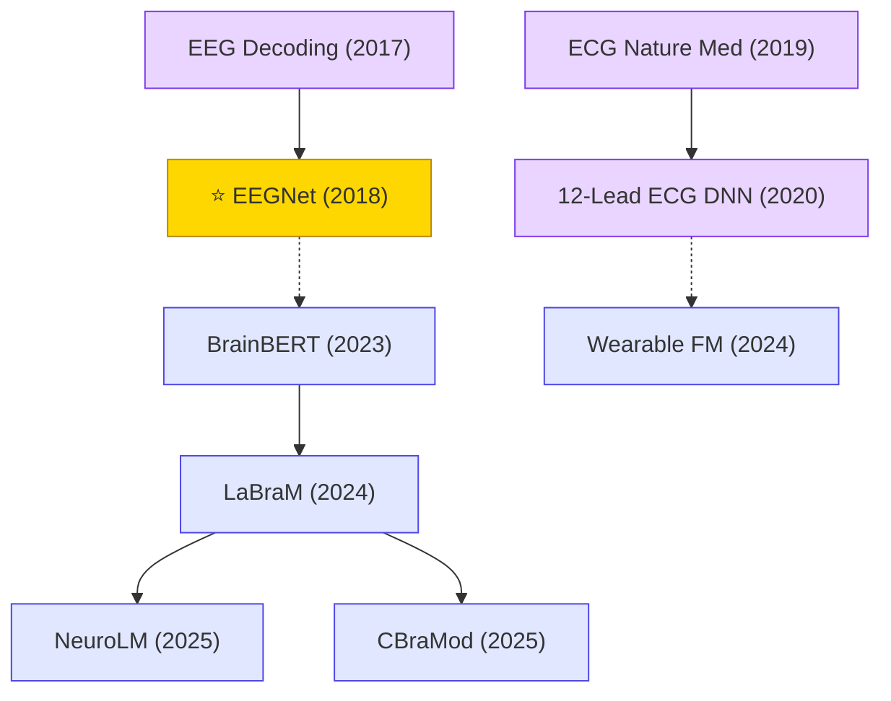

# Biomedical Signals

Deep learning for physiological signal decoding: EEG-based brain-computer interfaces, ECG arrhythmia classification, wearable biosignals (PPG), and large-scale biosignal foundation models.

## Tech Tree

### Paradigm Guide

| Paradigm | Description |
|:---|:---|
|  | Deep learning for EEG-based brain-computer interfaces, ECG arrhythmia classification, and physiological signal decoding |
|  | Large-scale pre-trained models for EEG/ECG biosignals enabling transfer learning and few-shot generalization |
|  | Pioneering works with high impact and citation, foundational to the field |

## Benchmark Datasets

| Dataset | Modality | Scale | Description |
|:---|:---|:---|:---|
| **BCI Competition IV (2a/2b)** | EEG | 9 subjects | Motor-imagery BCI benchmark; EEGNet evaluation |
| **PhysioNet MI** | EEG | 109 subjects | EEG Motor Movement/Imagery Dataset |
| **TUH EEG Corpus (TUEG)** | EEG | 30k+ recordings, 69k patients | Largest open clinical EEG corpus; pretraining corpus for LaBraM/CBraMod |
| **SEED / SEED-IV / DEAP** | EEG | — | Emotion recognition benchmarks |
| **MIT-BIH Arrhythmia** | ECG | 48 records | Classic ECG arrhythmia benchmark |
| **PhysioNet Challenge 2017 / 2020 / 2021** | ECG | 8k–88k records | Atrial fibrillation / 12-lead diagnosis challenges |
| **CPSC2018** | 12-lead ECG | 6,877 records | Chinese Physiological Signal Challenge; standard clinical ECG benchmark |
| **PTB-XL** | 12-lead ECG | 21,837 records | Large public clinical ECG dataset for supervised learning |
| **MIMIC-III / MIMIC-IV (waveforms)** | Multi-signal | 50k+ patients | ICU physiological signals for multi-task biosignal foundation models |

## SOTA Leaderboard

Representative state-of-the-art results (as of 2025) on standard biomedical-signal benchmarks. **Numbers are approximate and highly protocol-dependent** — subject-dependent vs. leave-one-subject-out (LOSO), intra-patient vs. inter-patient splits, and choice of metric can change the ranking. Several protocol-sensitive benchmarks (DEAP, EEGMMI, CHB-MIT, CPSC 2018, PPG HR) are intentionally omitted because no single "SOTA" applies.

### EEG — Motor Imagery BCI

| Benchmark | Metric | Method | Score | Year | Link |
|:---|:---|:---|:---|:---|:---|
| BCI Competition IV-2a (4-class, subject-dep.) | Accuracy | ATCNet | ~85.4% | 2022 | [IEEE TII](https://ieeexplore.ieee.org/document/9852687) |
| BCI Competition IV-2a (4-class, subject-dep.) | Accuracy | EEG Conformer | ~78.7% | 2023 | [IEEE TNSRE](https://ieeexplore.ieee.org/document/9991178) |
| BCI Competition IV-2a (cross-subject) | Accuracy | EEGPT | competitive ↑ | 2024 | [arXiv:2407.07721](https://arxiv.org/abs/2407.07721) |
| BCI Competition IV-2b (2-class, subject-dep.) | Accuracy | ATCNet / EEG Conformer | ~85% | 2022–23 | [ATCNet](https://ieeexplore.ieee.org/document/9852687) · [Conformer](https://ieeexplore.ieee.org/document/9991178) |

### EEG — Emotion Recognition

| Benchmark | Metric | Method | Score | Year | Link |
|:---|:---|:---|:---|:---|:---|
| SEED (3-class, subject-dep.) | Accuracy | CBraMod / LaBraM-Large / EEGPT | ~97–98% (saturated, cluster within ~1–2%) | 2024–25 | [CBraMod](https://arxiv.org/abs/2412.07236) · [LaBraM](https://arxiv.org/abs/2405.18765) · [EEGPT](https://arxiv.org/abs/2407.07721) |
| SEED-IV (4-class, subject-dep.) | Accuracy | CBraMod / LaBraM | high-80s% (verify against CBraMod Table) | 2024–25 | [CBraMod](https://arxiv.org/abs/2412.07236) |

### EEG — Sleep Staging

| Benchmark | Metric | Method | Score | Year | Link |
|:---|:---|:---|:---|:---|:---|
| Sleep-EDF-20 | Accuracy / MF1 | AttnSleep | ~84.4% / 78.1 MF1 | 2021 | [arXiv:2105.11043](https://arxiv.org/abs/2105.11043) |
| Sleep-EDF-78 | Accuracy | XSleepNet | ~84% | 2022 | [arXiv:2007.05492](https://arxiv.org/abs/2007.05492) |
| SHHS | Accuracy / κ | XSleepNet2 | ~87.6% / κ≈0.82 | 2022 | [arXiv:2007.05492](https://arxiv.org/abs/2007.05492) |

### EEG — Abnormal EEG Detection (TUH)

Cleanest benchmark progression — all three methods are foundation-model entries with public code.

| Benchmark | Metric | Method | Score | Year | Link |
|:---|:---|:---|:---|:---|:---|
| TUAB (binary) | AUROC | BIOT | ~0.879 | 2023 | [arXiv:2305.10351](https://arxiv.org/abs/2305.10351) |
| TUAB (binary) | AUROC | LaBraM-Large | ~0.902 | 2024 | [arXiv:2405.18765](https://arxiv.org/abs/2405.18765) |
| TUAB (binary) | AUROC | CBraMod | ~0.91 | 2025 | [arXiv:2412.07236](https://arxiv.org/abs/2412.07236) |
| TUEV (6-class event) | Balanced Acc / wF1 / κ | BIOT | 0.528 / 0.749 / 0.529 | 2023 | [arXiv:2305.10351](https://arxiv.org/abs/2305.10351) |
| TUEV (6-class event) | Balanced Acc / wF1 / κ | LaBraM-Large | 0.662 / 0.831 / 0.662 | 2024 | [arXiv:2405.18765](https://arxiv.org/abs/2405.18765) |
| TUEV (6-class event) | Balanced Acc | CBraMod | ~0.67 | 2025 | [arXiv:2412.07236](https://arxiv.org/abs/2412.07236) |

### ECG — Arrhythmia & 12-Lead Diagnosis

| Benchmark | Metric | Method | Score | Year | Link |
|:---|:---|:---|:---|:---|:---|
| PTB-XL (superclass, multi-label) | Macro-AUC | xResNet1d101 (Strodthoff baseline) | ~0.93 | 2020 | [arXiv:2004.13701](https://arxiv.org/abs/2004.13701) |
| PTB-XL (superclass, multi-label) | Macro-AUC | HuBERT-ECG / ECG-FM | ~0.94 (tight cluster) | 2024 | [ECG-FM arXiv:2408.05178](https://arxiv.org/abs/2408.05178) |
| PhysioNet/CinC 2020 (12-lead, multi-label) | Challenge metric | Prna / Natarajan et al. (winner) | ~0.533 on hidden test | 2020 | [CinC 2020](https://physionet.org/content/challenge-2020/) |
| PhysioNet/CinC 2021 (12-lead, multi-label) | Challenge metric | ISIBrno-AIMT (winner) | ~0.57 on hidden test | 2021 | [CinC 2021](https://moody-challenge.physionet.org/2021/) |
| MIT-BIH Arrhythmia (AAMI 5-class, inter-patient) | Accuracy | Mousavi & Afghah / Transformer-based | ~93–95% | 2019–24 | [arXiv:1812.07421](https://arxiv.org/abs/1812.07421) |

> **Caveat — MIT-BIH**: the *intra*-patient split saturates above 99% and is not meaningful for benchmarking. Always check which split a paper uses before comparing.

### Wearable Biosignals

| Benchmark | Metric | Method | Score | Year | Link |
|:---|:---|:---|:---|:---|:---|
| DeepBeat (PPG AF) | AUROC | DeepBeat (Torres-Soto & Ashley) | ~0.97 | 2020 | [npj Digital Medicine](https://www.nature.com/articles/s41746-020-00320-4) |
| Apple Wearable FM (PPG+ECG downstream) | Varies by task | Large-scale Wearable FM (Apple) | Strong transfer across cardiovascular / activity tasks | 2024 | [arXiv:2312.05409](https://arxiv.org/abs/2312.05409) |

## Contents

- [Classic Papers](classic.md) — Foundational and pioneering works
- [2025](2025.md) — NeuroLM · CBraMod large EEG foundation models
- [2024](2024.md) — LaBraM · Wearable biosignal foundation models
- [2023](2023.md) — BrainBERT intracranial EEG pre-training
- [2020](2020.md) — 12-lead ECG DNN clinical validation
- [2019](2019.md) — Cardiologist-level ECG arrhythmia detection
- [2018](2018.md) — ⭐ EEGNet compact CNN for BCI
- [2017](2017.md) — Braindecode deep EEG decoding
