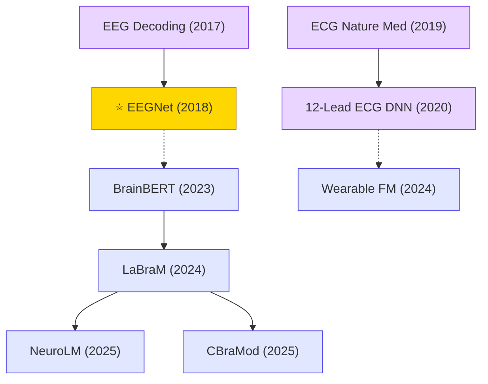

# Biomedical Signals

Deep learning for physiological signal decoding: EEG-based brain-computer interfaces, ECG arrhythmia classification, wearable biosignals (PPG), and large-scale biosignal foundation models.

## Tech Tree

### Paradigm Guide

| Paradigm | Description |
|:---|:---|
|  | Deep learning for EEG-based brain-computer interfaces, ECG arrhythmia classification, and physiological signal decoding |
|  | Large-scale pre-trained models for EEG/ECG biosignals enabling transfer learning and few-shot generalization |
|  | Pioneering works with high impact and citation, foundational to the field |

## Benchmark Datasets

| Dataset | Modality | Scale | Description |
|:---|:---|:---|:---|
| **BCI Competition IV (2a/2b)** | EEG | 9 subjects | Motor-imagery BCI benchmark; EEGNet evaluation |
| **PhysioNet MI** | EEG | 109 subjects | EEG Motor Movement/Imagery Dataset |
| **TUH EEG Corpus (TUEG)** | EEG | 30k+ recordings, 69k patients | Largest open clinical EEG corpus; pretraining corpus for LaBraM/CBraMod |
| **SEED / SEED-IV / DEAP** | EEG | — | Emotion recognition benchmarks |
| **MIT-BIH Arrhythmia** | ECG | 48 records | Classic ECG arrhythmia benchmark |
| **PhysioNet Challenge 2017 / 2020 / 2021** | ECG | 8k–88k records | Atrial fibrillation / 12-lead diagnosis challenges |
| **CPSC2018** | 12-lead ECG | 6,877 records | Chinese Physiological Signal Challenge; standard clinical ECG benchmark |
| **PTB-XL** | 12-lead ECG | 21,837 records | Large public clinical ECG dataset for supervised learning |
| **MIMIC-III / MIMIC-IV (waveforms)** | Multi-signal | 50k+ patients | ICU physiological signals for multi-task biosignal foundation models |

## Contents

- [Classic Papers](classic.md) — Foundational and pioneering works
- [2025](2025.md) — NeuroLM · CBraMod large EEG foundation models
- [2024](2024.md) — LaBraM · Wearable biosignal foundation models
- [2023](2023.md) — BrainBERT intracranial EEG pre-training
- [2020](2020.md) — 12-lead ECG DNN clinical validation
- [2019](2019.md) — Cardiologist-level ECG arrhythmia detection
- [2018](2018.md) — ⭐ EEGNet compact CNN for BCI
- [2017](2017.md) — Braindecode deep EEG decoding
