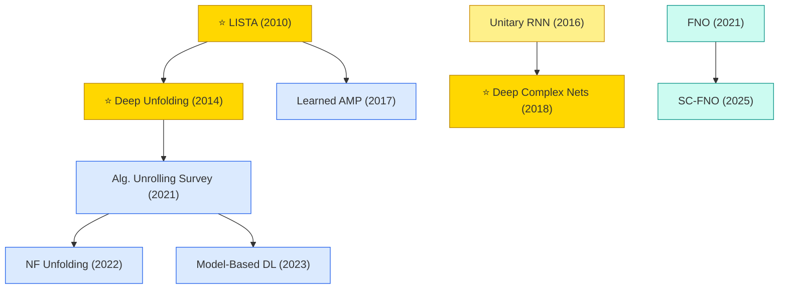

# General Methods (Cross-Signal Paradigms)

Signal-processing methodologies that are not tied to a specific signal type — algorithm unrolling, complex-valued networks, and neural operators. These paradigms are applied across communications, biomedical, imaging, and physics signals.

## Tech Tree

### Paradigm Guide

| Paradigm | Description |
|:---|:---|
|  | Deep networks derived by unrolling iterative optimization algorithms (ISTA, ADMM, AMP), combining interpretability of model-based methods with trainability of neural networks |
|  | Neural networks that natively handle complex-valued data (I/Q signals, Fourier coefficients) via complex convolutions and unitary recurrence |
|  | Learning mappings between function spaces (Fourier Neural Operator and extensions) for fast PDE solving and physics-informed signal processing |
|  | Pioneering works with high impact and citation, foundational to the field |

## Benchmark Datasets

| Dataset | Scale | Description |
|:---|:---|:---|
| **FNO Benchmark Suite** | Burgers / Darcy / Navier-Stokes | Canonical PDE benchmarks from the Fourier Neural Operator paper |
| **PDEBench** | 11 PDE families | Comprehensive benchmark for scientific ML / neural operators |
| **The Well** | 15 datasets, 15TB | Large-scale physics simulation corpus for training foundation PDE models |

## Contents

- [Classic Papers](classic.md) — Foundational and pioneering works (LISTA · Deep Unfolding · Deep Complex Nets)
- [2025](2025.md) — SC-FNO sensitivity-constrained neural operator
- [2023](2023.md) — Model-Based DL tutorial
- [2022](2022.md) — Normalizing-flow unfolding
- [2021](2021.md) — Algorithm Unrolling survey · FNO
- [2018](2018.md) — ⭐ Deep Complex Networks
- [2017](2017.md) — Learned AMP / Learned VAMP
- [2016](2016.md) — Full-capacity unitary RNN
