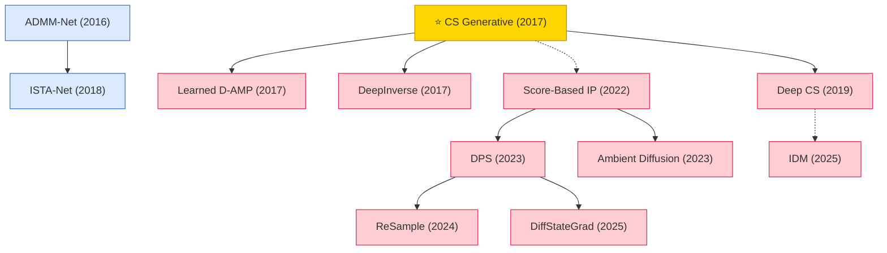

# Image & Video Signal Processing

Deep learning for image/video reconstruction and inverse problems — compressive sensing image recovery, MRI/CT reconstruction, and diffusion-based solvers for general noisy inverse problems. This subdomain overlaps with computer vision but is included because its methodology (sampling operators, forward models, iterative solvers) is fundamentally signal-processing.

## Tech Tree

### Paradigm Guide

| Paradigm | Description |
|:---|:---|
|  | Learned measurement and reconstruction for compressive sensing and inverse problems, from generative priors to diffusion-based solvers |
|  | Deep networks derived by unrolling iterative optimization algorithms (ISTA, ADMM) for image reconstruction |
|  | Pioneering works with high impact and citation, foundational to the field |

## Benchmark Datasets

| Dataset | Task | Description |
|:---|:---|:---|
| **Set11 / BSD68 / Urban100** | CS image reconstruction | Natural-image benchmarks reused for CS evaluation |
| **fastMRI** | MRI reconstruction | 1,500+ knee / brain MRI volumes; standard undersampled reconstruction benchmark |
| **Calgary-Campinas / SKM-TEA** | MRI reconstruction | Multi-coil brain / knee MRI benchmarks |
| **Mayo Low-Dose CT** | CT reconstruction | AAPM Low-Dose CT Grand Challenge data |
| **FFHQ / ImageNet validation** | Diffusion inverse problems | Used by DPS, ReSample, IDM, DiffStateGrad |

## Contents

- [Classic Papers](classic.md) — Foundational and pioneering works
- [2025](2025.md) — DiffStateGrad · IDM invertible diffusion CS
- [2024](2024.md) — ReSample latent-diffusion inverse solver
- [2023](2023.md) — DPS · Ambient Diffusion
- [2022](2022.md) — Score-based inverse problems for medical imaging
- [2019](2019.md) — Deep Compressed Sensing (meta-learning)
- [2018](2018.md) — ISTA-Net unrolled image CS
- [2017](2017.md) — ⭐ CS Generative · Learned D-AMP · DeepInverse
- [2016](2016.md) — Deep ADMM-Net for CS MRI
