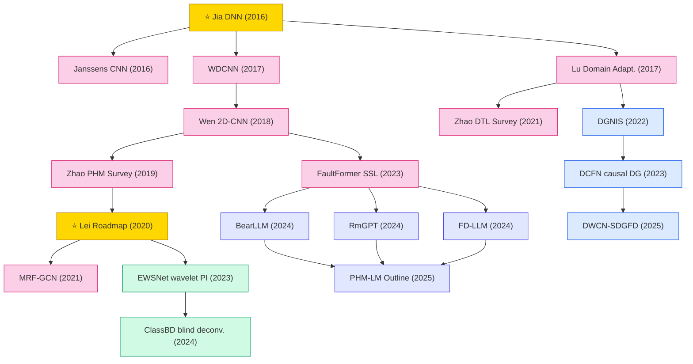

# Mechanical Fault Diagnosis (Vibration Signals)

Deep learning for rotating-machinery fault diagnosis and prognosis health management (PHM): bearing and gearbox fault classification from vibration / acoustic signals, cross-working-condition domain adaptation, and GNN-based machine fault diagnosis.

## Tech Tree

### Paradigm Guide

| Paradigm | Description |
|:---|:---|
|  | Deep learning for rotating-machinery fault diagnosis from vibration signals: bearing / gearbox classification, domain adaptation across working conditions, GNN-based diagnosis |
|  | Integration of signal-processing priors (wavelets, blind deconvolution, envelope analysis) with neural networks for interpretable and noise-robust diagnosis |
|  | Methods for unseen-condition / cross-machine diagnosis: invariant+specific features, causal disentanglement, single-source DG |
|  | Large pretrained / generative / LLM-based models for unified fault diagnosis, prognosis, and PHM reasoning |
|  | Pioneering works with high impact and citation, foundational to the field |

## Benchmark Datasets

| Dataset | Modality | Scale | Description |
|:---|:---|:---|:---|
| **CWRU Bearing** | Vibration | 4 fault types × multi-load | Case Western Reserve University bearing dataset — the de-facto standard benchmark for bearing fault diagnosis |
| **Paderborn (KAT)** | Vibration + Current | 32 bearings, real + artificial damage | Paderborn University bearing dataset with accelerated life-test and artificial damage classes |
| **MFPT** | Vibration | Baseline + outer/inner race faults | Machinery Failure Prevention Technology bearing dataset |
| **PHM 2009 Gearbox** | Vibration | 8 health conditions | PHM Society 2009 data challenge gearbox dataset |
| **XJTU-SY Bearing** | Run-to-failure vibration | 15 bearings, 3 conditions | Xi'an Jiaotong / Changxing Sumyoung run-to-failure dataset for RUL prediction |
| **IMS Bearing** | Run-to-failure vibration | 4 bearings × 3 run-to-failure tests | NASA IMS dataset for degradation / RUL modeling |
| **JNU / SEU Bearing** | Vibration | Multi-condition | Jiangnan / Southeast University datasets used in DTL benchmarks |
| **HUST Bearing / Gearbox** | Vibration | Multi-condition | Huazhong University of Science and Technology datasets used in LLM-PHM benchmarks (FD-LLM) |

## SOTA Notes

> **Why no head-to-head leaderboard?** Mechanical-diagnosis benchmarks are notoriously **protocol-inconsistent**: CWRU accuracy saturates above 99% under standard splits, while the informative signal lives in (a) noise level (SNR), (b) train/test working-condition pairs, (c) number of samples per class, (d) whether the split is cross-load / cross-fault-severity / cross-machine. A single "CWRU accuracy" column would mislead more than inform.
>
> **Verifiable protocol-tagged results worth knowing:**
>
> - **CWRU heavy-noise (−4 dB SNR, 10-class)** — ClassBD reports ~93–95% vs. baselines <80% (MSSP 2024, Table 2). Only comparable to other works matching this noise protocol.
> - **Cross-machine generalization (CWRU↔Paderborn)** — DCFN (MSSP 2023) sets a widely-cited causal-DG baseline; absolute numbers depend on source/target pairing.
> - **Single-source DG** — DWCN-SDGFD (MSSP 2025) targets the harder single-source setting than DGNIS (MSSP 2022).
> - **Multi-benchmark foundation models** — BearLLM claims SOTA across 9 public benchmarks with a single pretrained model (AAAI 2025); RmGPT reports strong one-shot 16-class classification (arXiv 2024).
>
> **Community resources for protocol-aware comparison:**
>
> - DG-PHM paper list: [CHAOZHAO-1/DG-PHM](https://github.com/CHAOZHAO-1/DG-PHM)
> - LLM-based PHM paper list: [CHAOZHAO-1/LLM-based-PHM](https://github.com/CHAOZHAO-1/LLM-based-PHM)

## Contents

- [Classic Papers](classic.md) — Foundational and pioneering works
- [2025](2025.md) — DWCN-SDGFD single-source DG · PHM-LM outline
- [2024](2024.md) — ClassBD physics-informed · BearLLM · RmGPT · FD-LLM (LLM/FM wave)
- [2023](2023.md) — EWSNet physics-informed · DCFN causal DG · FaultFormer SSL-transformer
- [2022](2022.md) — DGNIS domain generalization
- [2021](2021.md) — MRF-GCN · Zhao DTL survey
- [2020](2020.md) — ⭐ Lei roadmap survey
- [2019](2019.md) — Zhao PHM deep learning survey
- [2018](2018.md) — Wen 2D-CNN data-driven fault diagnosis
- [2017](2017.md) — WDCNN · Lu domain adaptation
- [2016](2016.md) — ⭐ Jia DNN · Janssens CNN
