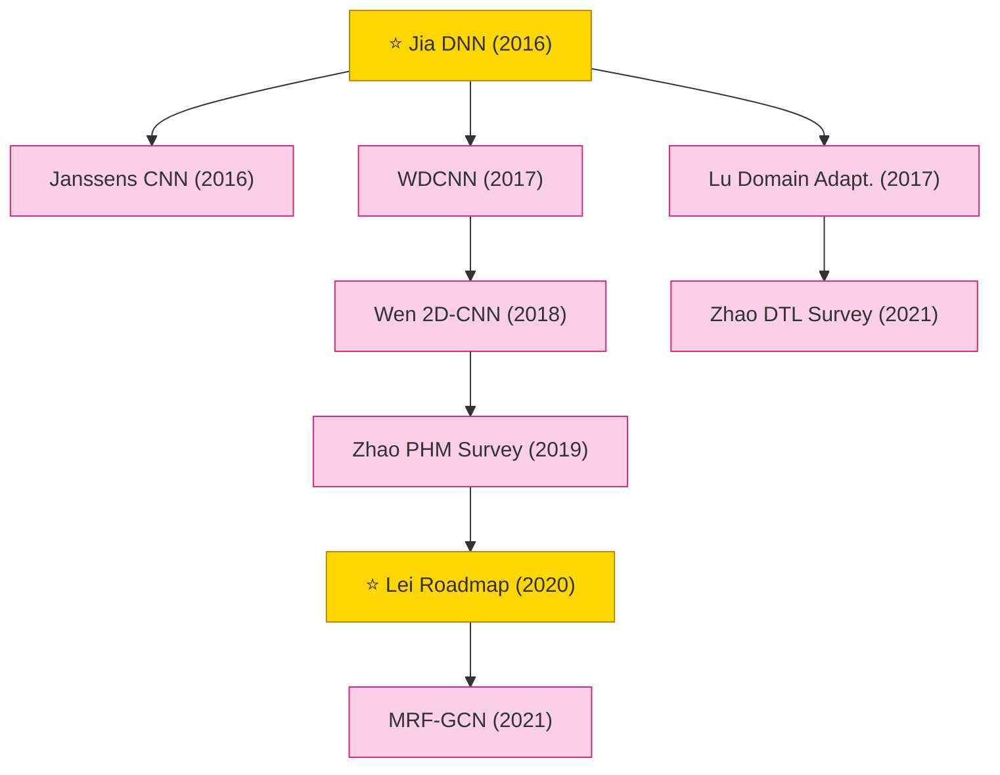

# Mechanical Fault Diagnosis (Vibration Signals)

Deep learning for rotating-machinery fault diagnosis and prognosis health management (PHM): bearing and gearbox fault classification from vibration / acoustic signals, cross-working-condition domain adaptation, and GNN-based machine fault diagnosis.

## Tech Tree

### Paradigm Guide

| Paradigm | Description |
|:---|:---|
|  | Deep learning for rotating-machinery fault diagnosis from vibration signals: bearing / gearbox classification, domain adaptation across working conditions, GNN-based diagnosis |
|  | Pioneering works with high impact and citation, foundational to the field |

## Benchmark Datasets

| Dataset | Modality | Scale | Description |
|:---|:---|:---|:---|
| **CWRU Bearing** | Vibration | 4 fault types × multi-load | Case Western Reserve University bearing dataset — the de-facto standard benchmark for bearing fault diagnosis |
| **Paderborn (KAT)** | Vibration + Current | 32 bearings, real + artificial damage | Paderborn University bearing dataset with accelerated life-test and artificial damage classes |
| **MFPT** | Vibration | Baseline + outer/inner race faults | Machinery Failure Prevention Technology bearing dataset |
| **PHM 2009 Gearbox** | Vibration | 8 health conditions | PHM Society 2009 data challenge gearbox dataset |
| **XJTU-SY Bearing** | Run-to-failure vibration | 15 bearings, 3 conditions | Xi'an Jiaotong / Changxing Sumyoung run-to-failure dataset for RUL prediction |
| **IMS Bearing** | Run-to-failure vibration | 4 bearings × 3 run-to-failure tests | NASA IMS dataset for degradation / RUL modeling |
| **JNU / SEU Bearing** | Vibration | Multi-condition | Jiangnan / Southeast University datasets used in DTL benchmarks |

## Contents

- [Classic Papers](classic.md) — Foundational and pioneering works
- [2021](2021.md) — MRF-GCN · Zhao DTL survey
- [2020](2020.md) — ⭐ Lei roadmap survey
- [2019](2019.md) — Zhao PHM deep learning survey
- [2018](2018.md) — Wen 2D-CNN data-driven fault diagnosis
- [2017](2017.md) — WDCNN · Lu domain adaptation
- [2016](2016.md) — ⭐ Jia DNN · Janssens CNN
