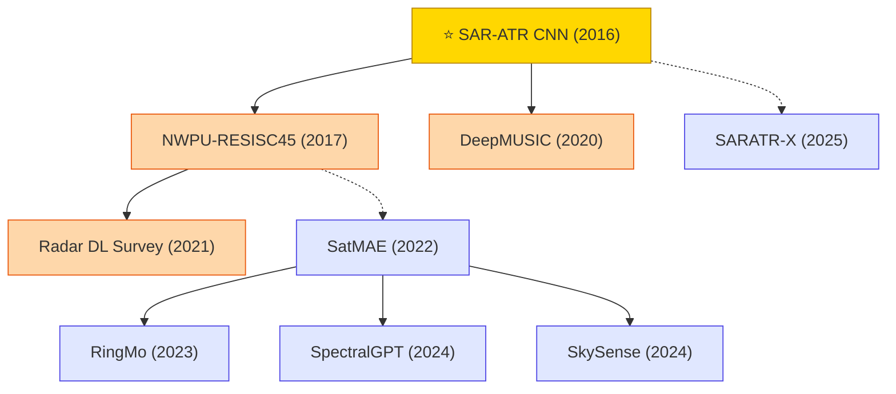

# Radar & Remote Sensing Signals

Deep learning for SAR automatic target recognition, remote-sensing scene classification, direction-of-arrival estimation, and multi-modal (optical + SAR + multispectral) foundation models.

## Tech Tree

### Paradigm Guide

| Paradigm | Description |
|:---|:---|
|  | CNNs and supervised models for SAR automatic target recognition, remote-sensing scene classification, and DOA estimation |
|  | Large-scale pre-trained models for remote-sensing imagery (optical + SAR + multispectral) enabling transfer and few-shot generalization |
|  | Pioneering works with high impact and citation, foundational to the field |

## Benchmark Datasets

| Dataset | Modality | Classes / Scale | Description |
|:---|:---|:---|:---|
| **MSTAR** | SAR | 10 vehicle classes, ~6k chips | X-band SAR target recognition benchmark (SOC / EOC) |
| **OpenSARShip / FUSAR-Ship** | SAR | ship types | Sentinel-1 / Gaofen-3 SAR ship classification |
| **UC Merced Land Use** | Optical | 21 classes × 100 | Early remote-sensing scene classification benchmark |
| **AID** | Optical | 30 classes × ~300 | Aerial-image scene classification |
| **NWPU-RESISC45** | Optical | 45 classes × 700 | Standard remote-sensing scene classification benchmark |
| **DOTA / DOTA-v2.0** | Aerial | 18 object classes | Oriented object detection in aerial imagery |
| **BigEarthNet-S1/S2** | SAR + Multispectral | 590k patches, 43 labels | Sentinel-1/2 multi-label land-cover benchmark for RSFMs |
| **SEN1-2 / SEN12MS** | SAR + Optical | 180k / 541k | Paired Sentinel-1/2 dataset for multimodal remote sensing |
| **fMoW / xView / iSAID** | High-res aerial | 1M / 1M / 655k objects | Functional map, general detection, and instance segmentation benchmarks |

## Contents

- [Classic Papers](classic.md) — Foundational and pioneering works
- [2025](2025.md) — SARATR-X SAR foundation model
- [2024](2024.md) — SpectralGPT · SkySense multimodal RS foundation models
- [2023](2023.md) — RingMo RS foundation model
- [2022](2022.md) — SatMAE multispectral pre-training
- [2021](2021.md) — Radar deep learning survey
- [2020](2020.md) — DeepMUSIC DOA estimation
- [2017](2017.md) — NWPU-RESISC45 benchmark
- [2016](2016.md) — ⭐ SAR-ATR all-convolutional networks
