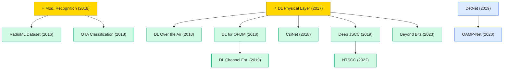

# Wireless & Communication Signals

Deep learning for physical-layer communications: autoencoder-based transceivers, modulation recognition, channel estimation, CSI feedback, MIMO detection, and semantic / joint source-channel coding.

## Tech Tree

### Paradigm Guide

| Paradigm | Description |
|:---|:---|
|  | Deep learning for physical-layer problems: autoencoder-based transceivers, modulation recognition, channel estimation, CSI feedback, semantic communications |
|  | Unrolling iterative optimization algorithms (projected gradient, AMP) into trainable networks for MIMO detection |
|  | Pioneering works with high impact and citation, foundational to the field |

## Benchmark Datasets

| Dataset | Task | Scale | Description |
|:---|:---|:---|:---|
| **RadioML 2016.10a / 10b** | Modulation recognition | 220k / 1.2M samples, 11 classes | GNU Radio synthetic RF signals over varying SNR; DeepSig benchmark |
| **RadioML 2018.01a** | Modulation recognition | 2.56M samples, 24 classes | Over-the-air captures plus synthetic channels |
| **CSI Dataset (COST2100)** | CSI feedback | — | Standard channel for CsiNet-family evaluation |
| **DeepMIMO** | MIMO / beam prediction | Ray-tracing | Parametrized mmWave and massive-MIMO channel dataset |
| **ViWi / Raymobtime** | V2X / beam selection | Multi-modal | Vision-aided / ray-traced channel datasets |

## Contents

- [Classic Papers](classic.md) — Foundational and pioneering works
- [2023](2023.md) — Semantic / task-oriented communications tutorial
- [2022](2022.md) — Nonlinear transform source-channel coding (NTSCC)
- [2020](2020.md) — OAMP-Net MIMO detection
- [2019](2019.md) — DetNet · Deep JSCC · DL channel estimation
- [2018](2018.md) — End-to-end OTA communication · OFDM · CsiNet · OTA radio classification
- [2017](2017.md) — ⭐ Physical-layer autoencoder
- [2016](2016.md) — ⭐ Modulation recognition · RadioML dataset
