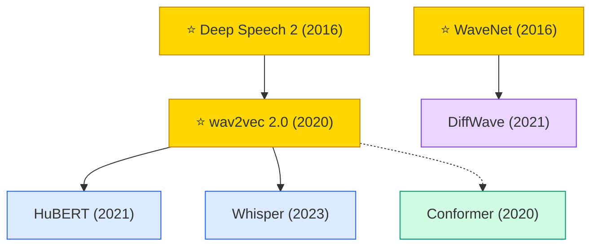

# Speech & Audio

A collection of must-read speech and audio processing papers from top venues.

## Tech Tree

### Paradigm Guide

| Paradigm | Description |
|:---|:---|
|  | Models that directly map raw audio to text, eliminating hand-crafted feature pipelines |
|  | Designs combining convolution and self-attention for joint local and global audio modeling |
|  | Neural vocoders and generative models that synthesize high-fidelity audio waveforms |
|  | Pioneering works with high impact and citation, foundational to the field |

## Contents

- [Classic Papers](classic.md) — Foundational and pioneering works
- [2024](2024.md)
- [2023](2023.md)
- [2021](2021.md)
- [2020](2020.md)
