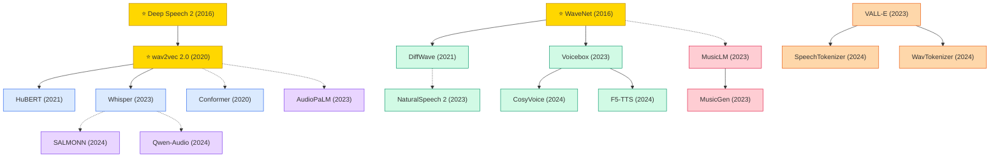

# Speech & Audio

A collection of must-read speech and audio processing papers from top venues.

## Tech Tree

### Paradigm Guide

| Paradigm | Description |
|:---|:---|
|  | End-to-end models mapping raw audio to text, from self-supervised pre-training (wav2vec) to robust large-scale ASR (Whisper) |
|  | Neural TTS and audio generation, from autoregressive vocoders (WaveNet) to non-autoregressive flow-matching systems (F5-TTS) |
|  | Audio tokenization converting speech into discrete tokens, enabling language-model-based speech generation (VALL-E) |
|  | Large language models extended with audio understanding for universal speech and sound reasoning |
|  | Models synthesizing music from text descriptions or audio prompts via generative modeling |
|  | Pioneering works with high impact and citation, foundational to the field |

## Contents

- [Classic Papers](classic.md) — Foundational and pioneering works
- [2024](2024.md)
- [2023](2023.md)
- [2021](2021.md)
- [2020](2020.md)
