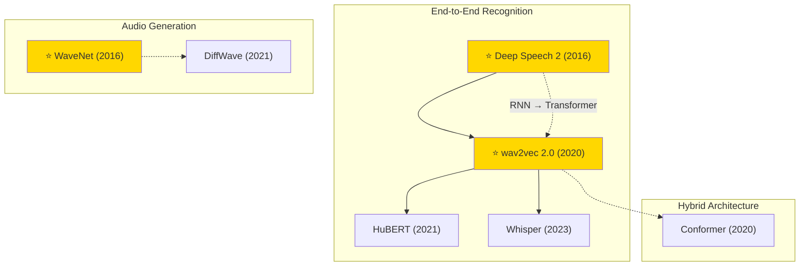

# Speech & Audio

A collection of must-read speech and audio processing papers from top venues.

## Tech Tree

## Contents

- [Classic Papers](classic.md) — Foundational and pioneering works
- [2023](2023.md)
- [2021](2021.md)
- [2020](2020.md)
