# Speech & Audio

A collection of must-read speech and audio processing papers from top venues.

## Tech Tree

```mermaid
graph TD
    classDef asr fill:#DBEAFE,stroke:#2563EB
    classDef tts fill:#D1FAE5,stroke:#059669
    classDef codec fill:#FED7AA,stroke:#EA580C
    classDef llm fill:#E9D5FF,stroke:#7C3AED
    classDef music fill:#FECDD3,stroke:#E11D48
    classDef star fill:#FFD700,stroke:#B8860B

    DeepSpeech["⭐ Deep Speech 2 (2016)"]:::star --> wav2vec2["⭐ wav2vec 2.0 (2020)"]:::star
    wav2vec2 --> HuBERT["HuBERT (2021)"]:::asr
    wav2vec2 --> Whisper["Whisper (2023)"]:::asr
    wav2vec2 -.-> Conformer["Conformer (2020)"]:::asr
    BEATs["BEATs (2023)"]:::asr -.-> SALMONN["SALMONN (2024)"]:::llm

    WaveNet["⭐ WaveNet (2016)"]:::star --> Tacotron2["Tacotron 2 (2018)"]:::tts
    Tacotron["Tacotron (2017)"]:::tts --> Tacotron2
    Tacotron2 --> FastSpeech["FastSpeech (2019)"]:::tts
    FastSpeech --> FastSpeech2["FastSpeech 2 (2021)"]:::tts
    FastSpeech --> GlowTTS["Glow-TTS (2020)"]:::tts
    GlowTTS --> VITS["VITS (2021)"]:::tts
    VITS -.-> StyleTTS2["StyleTTS 2 (2023)"]:::tts

    WaveNet --> DiffWave["DiffWave (2021)"]:::tts
    DiffWave -.-> NatSpeech2["NaturalSpeech 2 (2024)"]:::tts
    NatSpeech["NaturalSpeech (2022)"]:::tts --> NatSpeech2
    NatSpeech2 --> NatSpeech3["NaturalSpeech 3 (2024)"]:::tts
    NatSpeech3 -.-> DiTToTTS["DiTTo-TTS (2025)"]:::tts
    NatSpeech3 -.-> DiTAR["DiTAR (2025)"]:::tts

    Voicebox["Voicebox (2023)"]:::tts --> CosyVoice["CosyVoice (2024)"]:::tts
    Voicebox --> F5TTS["F5-TTS (2024)"]:::tts
    CosyVoice --> CosyVoice2["CosyVoice 2 (2024)"]:::tts

    SoundStream["SoundStream (2021)"]:::codec --> EnCodec["EnCodec (2022)"]:::codec
    EnCodec --> AudioLM["AudioLM (2022)"]:::codec
    AudioLM --> VALLE["VALL-E (2023)"]:::codec
    VALLE --> VALLE2["VALL-E 2 (2024)"]:::codec
    VALLE --> SpeechTokenizer["SpeechTokenizer (2024)"]:::codec
    VALLE --> WavTokenizer["WavTokenizer (2025)"]:::codec
    VALLE --> MaskGCT["MaskGCT (2025)"]:::codec
    VALLE --> HALLE["HALL-E (2025)"]:::codec
    VALLE -.-> SparkTTS["Spark-TTS (2025)"]:::tts
    WavTokenizer -.-> TASTE["TASTE (2026)"]:::codec

    Whisper -.-> SALMONN
    Whisper -.-> QwenAudio["Qwen-Audio (2024)"]:::llm
    QwenAudio --> Qwen2Audio["Qwen2-Audio (2024)"]:::llm
    Qwen2Audio --> Qwen25Omni["Qwen2.5-Omni (2025)"]:::llm
    AudioPaLM["AudioPaLM (2023)"]:::llm -.-> GLM4Voice["GLM-4-Voice (2024)"]:::llm
    AudioPaLM -.-> StepAudio["Step-Audio (2025)"]:::llm
    AudioLM -.-> Moshi["Moshi (2024)"]:::llm
    Moshi -.-> CALM["CALM (2026)"]:::tts
    HuBERT -.-> LST["LST (2026)"]:::llm
    Qwen2Audio -.-> Echo["Echo (2026)"]:::llm

    WaveNet -.-> MusicLM["MusicLM (2023)"]:::music
    MusicLM --> MusicGen["MusicGen (2023)"]:::music
    MusicGen -.-> Presto["Presto! (2025)"]:::music
```

### Paradigm Guide

| Paradigm | Description |
|:---|:---|
|  | End-to-end models mapping raw audio to text, from self-supervised pre-training (wav2vec, HuBERT) to robust large-scale ASR (Whisper) and audio understanding (BEATs) |
|  | Neural TTS and audio generation, from autoregressive vocoders (WaveNet) through non-autoregressive flow-matching (F5-TTS) to diffusion transformer systems (DiTAR) |
|  | Audio tokenization converting speech into discrete tokens, enabling language-model-based speech generation from SoundStream/EnCodec to VALL-E and beyond |
|  | Large language models extended with audio understanding and generation, from multimodal audio reasoning (SALMONN) to real-time spoken dialogue (Moshi) |
|  | Models synthesizing music from text descriptions or audio prompts via generative modeling, with emerging acceleration techniques (Presto!) |
|  | Pioneering works with high impact and citation, foundational to the field |

## Contents

- [Classic Papers](classic.md) — Foundational and pioneering works

- [2026](2026.md) — **语音-文本联合建模新范式**
  ICLR 2026 聚焦语音与文本的深度对齐——LST 用潜在语音 patch 对齐文本单元大幅提升预训练效率（Oral），CALM 用连续 VAE 帧替代离散 token 实现更高保真度的音频语言建模，TASTE 通过文本对齐的语音 tokenization 统一语音语言建模，Echo 提出音频交错推理提升大型音频语言模型的理解能力

- [2025](2025.md) — **Diffusion Transformer 入场 · Codec 高效化 · 统一语音交互**
  Diffusion Transformer 全面进入语音生成（DiTTo-TTS、DiTAR），MaskGCT 用掩码生成消除 TTS 中的显式文本-语音对齐，WavTokenizer 和 HALL-E 推进 codec 效率和长文本合成，Presto! 大幅加速音乐生成，Spark-TTS 通过 BiCodec 实现可控 LLM-TTS，Step-Audio 和 Qwen2.5-Omni 推进统一语音交互模型的规模

- [2024](2024.md) — **Zero-Shot TTS 成熟 · 端到端语音对话 · 音频大语言模型**
  NaturalSpeech 系列推进到第三代，用分解式 codec 和扩散模型实现细粒度 zero-shot 合成；CosyVoice 和 F5-TTS 代表 flow-matching TTS 的成熟；Seed-TTS 和 VALL-E 2 达到 human-parity zero-shot TTS；SpeechTokenizer 统一语义和声学 token；SALMONN 和 Qwen 系列将 LLM 扩展到通用音频理解；GLM-4-Voice 和 Moshi 探索端到端语音对话

- [2023](2023.md) — **Codec 语言模型开创 · 大规模 ASR · 音乐生成**
  Whisper 以 68 万小时弱监督数据训练出鲁棒的多语言 ASR 基础模型；VALL-E 将 TTS 重新定义为 codec token 上的语言建模任务，开创 zero-shot 语音克隆范式；Voicebox 用 flow-matching 实现大规模非自回归语音生成；StyleTTS 2 通过风格扩散达到人类水平 TTS；BEATs 推进音频自监督预训练；AudioPaLM 和 Pengi 探索 LLM 的语音理解；MusicLM 和 MusicGen 开辟文本驱动音乐生成方向

- [2022](2022.md) — **神经音频编解码器 · 音频语言建模奠基**
  EnCodec 用 RVQ 实现流式高保真音频压缩，AudioLM 首次证明语言模型可通过分层建模语义和声学 token 生成连贯音频，二者共同构建了 codec 语言模型的基础范式；NaturalSpeech 通过 VAE 系统在 LJSpeech 上首次实现人类水平语音质量

- [2021](2021.md) — **自监督语音学习 · TTS 多路线并进 · 神经编解码器起步**
  HuBERT 通过掩码预测推进语音自监督学习；VITS 首次将 VAE、流模型和对抗训练统一到单阶段端到端 TTS；FastSpeech 2 和 Grad-TTS 分别从非自回归和扩散角度优化 TTS；DiffWave 将扩散模型引入音频波形合成；SoundStream 提出基于 RVQ 的神经音频编解码器，为后续 codec 语言模型奠基

- [2020](2020.md) — **Conformer 架构 · Flow-based TTS · 自监督预训练**
  Conformer 融合 Transformer 自注意力与卷积模块成为 ASR 标准架构；Glow-TTS 将 flow 模型引入 TTS 实现并行合成；wav2vec 2.0 通过对比学习和量化建立语音自监督学习的基本框架

- [2019](2019.md) — **非自回归 TTS 开端 · 语音自监督预训练先河**
  FastSpeech 提出非自回归 TTS 实现 270 倍加速，开启了非自回归语音合成的研究方向；SpecAugment 以极简的频谱遮蔽策略大幅提升 ASR 性能；wav2vec 开启语音自监督预训练先河

- [2018](2018.md) — **神经 TTS 达到接近人类质量 · 实时合成 · 语音克隆**
  Tacotron 2 将序列到序列模型与 WaveNet vocoder 结合达到接近人类的语音质量；Parallel WaveNet 通过概率密度蒸馏实现实时高保真合成；SV2TTS 开创基于说话人验证的多说话人语音克隆方向

- [2017](2017.md) — **端到端 TTS 起步 · 无条件音频生成**
  Tacotron 提出首个端到端序列到序列 TTS 模型，直接从字符生成频谱图，简化了传统 TTS 流水线；SampleRNN 用多分辨率层次化 RNN 建模原始音频波形，探索无条件音频生成
