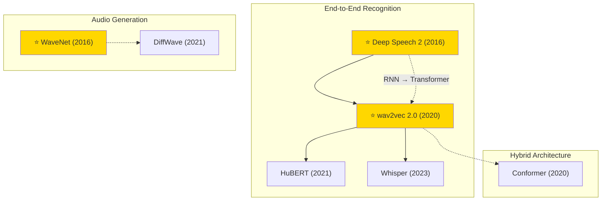

# Speech & Audio — Tech Tree

## Key Evolution Paths

| Path | Description |
|------|-------------|
| **Recognition** | Deep Speech 2 (RNN+CTC) → wav2vec 2.0 (self-supervised) → Whisper (large-scale weak supervision) |
| **Self-Supervised** | wav2vec 2.0 → HuBERT (masked prediction on clusters) |
| **Hybrid** | Transformer + CNN → Conformer (best of both) |
| **Generation** | WaveNet (autoregressive CNN) → DiffWave (diffusion-based) |
| **Key Shift** | From supervised RNN to self-supervised Transformer representations |
