# Time Series Forecasting (TSF)

A collection of must-read time series forecasting papers from top venues.

## Tech Tree

```mermaid
graph TD
    classDef trans fill:#DBEAFE,stroke:#2563EB
    classDef mlp fill:#D1FAE5,stroke:#059669
    classDef cnn fill:#FED7AA,stroke:#EA580C
    classDef rnn fill:#E9D5FF,stroke:#7C3AED
    classDef norm fill:#FECDD3,stroke:#E11D48
    classDef freq fill:#FEF08A,stroke:#CA8A04
    classDef ssm fill:#CCFBF1,stroke:#0D9488
    classDef fm fill:#E0E7FF,stroke:#4F46E5
    classDef prob fill:#E5E7EB,stroke:#4B5563
    classDef repr fill:#DDD6FE,stroke:#7C3AED
    classDef star fill:#FFD700,stroke:#B8860B

    LogTrans["LogTrans (2019)"]:::trans --> Informer["⭐ Informer (2021)"]:::star
    Informer --> Autoformer["⭐ Autoformer (2021)"]:::trans
    Autoformer --> FEDformer["FEDformer (2022)"]:::trans
    Informer --> PatchTST["PatchTST (2023)"]:::trans
    PatchTST --> iTransformer["iTransformer (2024)"]:::trans
    PatchTST --> Pathformer["Pathformer (2024)"]:::trans
    iTransformer --> TimeXer["TimeXer (2024)"]:::trans
    iTransformer --> TimeBridge["TimeBridge (2025)"]:::trans
    iTransformer --> HDT["HDT (2025)"]:::trans
    TimeXer --> EMAformer["EMAformer (2026)"]:::trans
    TimeBridge --> APN["APN (2026)"]:::trans

    NBEATS["⭐ N-BEATS (2020)"]:::star --> Linear["⭐ LTSF-Linear (2023)"]:::star
    NBEATS --> NHiTS["N-HiTS (2023)"]:::mlp
    Linear --> TiDE["TiDE (2023)"]:::mlp
    Linear --> TSMixer["TSMixer (2023)"]:::mlp
    Linear --> Koopa["Koopa (2023)"]:::mlp
    Linear --> TimeMixer["TimeMixer (2024)"]:::mlp
    TimeMixer --> TimeMixerPP["TimeMixer++ (2025)"]:::mlp
    Linear --> SOFTS["SOFTS (2024)"]:::mlp
    Linear --> TimeBase["TimeBase (2025)"]:::mlp

    TCN["TCN (2018)"]:::cnn --> SCINet["SCINet (2022)"]:::cnn
    TCN --> TimesNet["TimesNet (2023)"]:::cnn
    TCN --> ModernTCN["ModernTCN (2024)"]:::cnn
    TimesNet -.-> xPatch["xPatch (2025)"]:::cnn

    LSTM["LSTM"]:::rnn --> DeepAR["⭐ DeepAR (2020)"]:::rnn
    LSTM --> LSTNet["LSTNet (2018)"]:::rnn
    DeepAR --> TFT["TFT (2021)"]:::rnn
    TFT --> SegRNN["SegRNN (2023)"]:::rnn

    RevIN["⭐ RevIN (2022)"]:::norm --> DishTS["Dish-TS (2023)"]:::norm
    DishTS --> SAN["SAN (2024)"]:::norm

    FEDformer -.-> FiLM["FiLM (2022)"]:::freq
    FiLM --> FreTS["FreTS (2023)"]:::freq
    FreTS --> FITS["FITS (2024)"]:::freq
    FreTS --> PDF["PDF (2024)"]:::freq
    FreTS --> FilterNet["FilterNet (2024)"]:::freq
    FreTS --> CycleNet["CycleNet (2024)"]:::freq

    S4["S4 (2022)"]:::ssm --> TimeMachine["TimeMachine (2024)"]:::ssm
    S4 --> SMamba["S-Mamba (2024)"]:::ssm
    SMamba --> MambaTS["MambaTS (2024)"]:::ssm
    S4 --> LinOSS["LinOSS (2025)"]:::ssm
    SMamba --> msMamba["ms-Mamba (2026)"]:::ssm

    PatchTST -.-> TimesFM["TimesFM (2024)"]:::fm
    PatchTST -.-> Timer["Timer (2024)"]:::fm
    Timer --> MOIRAI["MOIRAI (2024)"]:::fm
    Timer --> Moment["MOMENT (2024)"]:::fm
    Timer --> Sundial["Sundial (2025)"]:::fm
    MOIRAI --> MoiraiMoE["Moirai-MoE (2025)"]:::fm
    MOIRAI --> Moirai2["Moirai 2.0 (2025)"]:::fm
    Sundial -.-> Aurora["Aurora (2026)"]:::fm
    Sundial -.-> OccamVTS["OccamVTS (2026)"]:::fm
    GPTx["GPT-2"]:::fm -.-> GPT4TS["GPT4TS (2023)"]:::fm
    GPTx -.-> TimeLLM["Time-LLM (2024)"]:::fm
    GPTx -.-> AutoTimes["AutoTimes (2024)"]:::fm
    TimeLLM -.-> SELLM["SE-LLM (2026)"]:::fm
    Chronos["Chronos (2024)"]:::fm --> Chronos2["Chronos-2 (2025)"]:::fm
    TimeMoE["Time-MoE (2025)"]:::fm
    TSRAG["TS-RAG (2025)"]:::fm

    DeepAR -.-> TimeGrad["TimeGrad (2021)"]:::prob
    TimeGrad --> ARMD["ARMD (2025)"]:::prob
    TimeGrad --> NsDiff["NsDiff (2025)"]:::prob
    TimeGrad -.-> CNDiff["CNDiff (2025)"]:::prob
    Koopa -.-> K2VAE["K²VAE (2025)"]:::prob

    TS2Vec["TS2Vec (2022)"]:::repr --> CoST["CoST (2022)"]:::repr

    Linear -.->|"challenges"| Informer
    RevIN -.-> PatchTST
```

### Paradigm Guide

| Paradigm | Description |
|:---|:---|
|  | Self-attention architectures adapted for temporal dependencies, from sparse attention (Informer) to patching (PatchTST) and inverted designs (iTransformer) |
|  | Pure feedforward networks that challenge Transformer complexity, showing simple linear models can be surprisingly competitive |
|  | Temporal convolution approaches capturing local patterns, evolving from TCN to 2D-variation (TimesNet) and modern large-kernel designs |
|  | Recurrent architectures for sequential modeling, including probabilistic variants (DeepAR) and attention-augmented hybrids (TFT) |
|  | Methods addressing distribution shift and non-stationarity in time series via reversible or adaptive normalization |
|  | Approaches operating in spectral space, leveraging Fourier or Legendre transforms for efficient temporal pattern extraction |
|  | State space models with selective mechanisms, offering linear-complexity alternatives for long-range temporal modeling |
|  | Large-scale pretrained models for zero-shot or few-shot forecasting, including LLM reprogramming and time series foundation models |
|  | Distributional forecasting via diffusion (ARMD, NsDiff), VAE (K²VAE), or autoregressive likelihood, capturing uncertainty beyond point estimates |
|  | Self-supervised and contrastive methods learning universal time series representations for downstream tasks |
|  | Pioneering works with high impact and citation, foundational to the field |

## Contents

- [Classic Papers](classic.md) — Foundational and pioneering works
- [2026](2026.md)
- [2025](2025.md)
- [2024](2024.md)
- [2023](2023.md)
- [2022](2022.md)
- [2021](2021.md)
- [2020](2020.md)
- [2019](2019.md)
- [2018](2018.md)
- [2017](2017.md)
