# Time Series Forecasting (TSF)

A collection of must-read time series forecasting papers from top venues.

## Tech Tree

```mermaid
graph TD
    classDef trans fill:#DBEAFE,stroke:#2563EB
    classDef mlp fill:#D1FAE5,stroke:#059669
    classDef cnn fill:#FED7AA,stroke:#EA580C
    classDef rnn fill:#E9D5FF,stroke:#7C3AED
    classDef norm fill:#FECDD3,stroke:#E11D48
    classDef freq fill:#FEF08A,stroke:#CA8A04
    classDef ssm fill:#CCFBF1,stroke:#0D9488
    classDef fm fill:#E0E7FF,stroke:#4F46E5
    classDef prob fill:#E5E7EB,stroke:#4B5563
    classDef repr fill:#DDD6FE,stroke:#7C3AED
    classDef star fill:#FFD700,stroke:#B8860B

    LogTrans["LogTrans (2019)"]:::trans --> Informer["⭐ Informer (2021)"]:::star
    Informer --> Autoformer["⭐ Autoformer (2021)"]:::trans
    Autoformer --> FEDformer["FEDformer (2022)"]:::trans
    Informer --> PatchTST["PatchTST (2023)"]:::trans
    PatchTST --> iTransformer["iTransformer (2024)"]:::trans
    PatchTST --> Pathformer["Pathformer (2024)"]:::trans
    iTransformer --> TimeXer["TimeXer (2024)"]:::trans
    iTransformer --> TimeBridge["TimeBridge (2025)"]:::trans
    iTransformer --> HDT["HDT (2025)"]:::trans
    TimeXer --> EMAformer["EMAformer (2026)"]:::trans
    TimeBridge --> APN["APN (2026)"]:::trans
    TimeXer -.-> GTR["GTR (2026)"]:::trans

    NBEATS["⭐ N-BEATS (2020)"]:::star --> Linear["⭐ DLinear (2023)"]:::star
    NBEATS --> NHiTS["N-HiTS (2023)"]:::mlp
    Linear --> TiDE["TiDE (2023)"]:::mlp
    Linear --> TSMixer["TSMixer (2023)"]:::mlp
    Linear --> Koopa["Koopa (2023)"]:::mlp
    Linear --> TimeMixer["TimeMixer (2024)"]:::mlp
    TimeMixer --> TimeMixerPP["TimeMixer++ (2025)"]:::mlp
    Linear --> SOFTS["SOFTS (2024)"]:::mlp
    Linear --> PatchMLP["PatchMLP (2025)"]:::mlp
    Linear --> TimeBase["TimeBase (2025)"]:::mlp

    TCN["TCN (2018)"]:::cnn --> SCINet["SCINet (2022)"]:::cnn
    TCN --> TimesNet["TimesNet (2023)"]:::cnn
    TCN --> ModernTCN["ModernTCN (2024)"]:::cnn
    TimesNet -.-> xPatch["xPatch (2025)"]:::cnn

    LSTM["LSTM"]:::rnn --> DeepAR["⭐ DeepAR (2020)"]:::rnn
    LSTM --> LSTNet["LSTNet (2018)"]:::rnn
    DeepAR --> TFT["TFT (2021)"]:::rnn
    TFT --> SegRNN["SegRNN (2023)"]:::rnn

    RevIN["⭐ RevIN (2022)"]:::norm --> DishTS["Dish-TS (2023)"]:::norm
    DishTS --> SAN["SAN (2024)"]:::norm

    FEDformer -.-> FiLM["FiLM (2022)"]:::freq
    FiLM --> FreTS["FreTS (2023)"]:::freq
    FiLM --> WPMixer["WPMixer (2025)"]:::freq
    FreTS --> FITS["FITS (2024)"]:::freq
    FreTS --> PDF["PDF (2024)"]:::freq
    FreTS --> FilterNet["FilterNet (2024)"]:::freq
    FreTS --> CycleNet["CycleNet (2024)"]:::freq

    S4["S4 (2022)"]:::ssm --> TimeMachine["TimeMachine (2024)"]:::ssm
    S4 --> SMamba["S-Mamba (2024)"]:::ssm
    SMamba --> MambaTS["MambaTS (2024)"]:::ssm
    S4 --> LinOSS["LinOSS (2025)"]:::ssm
    SMamba --> msMamba["ms-Mamba (2026)"]:::ssm

    PatchTST -.-> TimesFM["TimesFM (2024)"]:::fm
    PatchTST -.-> Timer["Timer (2024)"]:::fm
    Timer --> MOIRAI["MOIRAI (2024)"]:::fm
    Timer --> Moment["MOMENT (2024)"]:::fm
    Timer --> Sundial["Sundial (2025)"]:::fm
    Timer --> TimerXL["Timer-XL (2025)"]:::fm
    MOIRAI --> MoiraiMoE["Moirai-MoE (2025)"]:::fm
    MOIRAI --> Moirai2["Moirai 2.0 (2025)"]:::fm
    Sundial -.-> Aurora["Aurora (2026)"]:::fm
    Sundial -.-> OccamVTS["OccamVTS (2026)"]:::fm
    GPTx["GPT-2"]:::fm -.-> GPT4TS["GPT4TS (2023)"]:::fm
    GPTx -.-> TimeLLM["Time-LLM (2024)"]:::fm
    GPTx -.-> AutoTimes["AutoTimes (2024)"]:::fm
    TimeLLM -.-> SELLM["SE-LLM (2026)"]:::fm
    Chronos["Chronos (2024)"]:::fm --> Chronos2["Chronos-2 (2025)"]:::fm
    TimeMoE["Time-MoE (2025)"]:::fm
    TSRAG["TS-RAG (2025)"]:::fm

    DeepAR -.-> TimeGrad["TimeGrad (2021)"]:::prob
    TimeGrad --> ARMD["ARMD (2025)"]:::prob
    TimeGrad --> NsDiff["NsDiff (2025)"]:::prob
    TimeGrad -.-> CNDiff["CNDiff (2025)"]:::prob
    Koopa -.-> K2VAE["K²VAE (2025)"]:::prob

    TS2Vec["TS2Vec (2022)"]:::repr --> CoST["CoST (2022)"]:::repr

    Linear -.->|"challenges"| Informer
    RevIN -.-> PatchTST
```

### Paradigm Guide

| Paradigm | Description |
|:---|:---|
|  | Self-attention architectures adapted for temporal dependencies, from sparse attention (Informer) to patching (PatchTST) and inverted designs (iTransformer) |
|  | Pure feedforward networks that challenge Transformer complexity, showing simple linear models can be surprisingly competitive |
|  | Temporal convolution approaches capturing local patterns, evolving from TCN to 2D-variation (TimesNet) and modern large-kernel designs |
|  | Recurrent architectures for sequential modeling, including probabilistic variants (DeepAR) and attention-augmented hybrids (TFT) |
|  | Methods addressing distribution shift and non-stationarity in time series via reversible or adaptive normalization |
|  | Approaches operating in spectral space, leveraging Fourier or Legendre transforms for efficient temporal pattern extraction |
|  | State space models with selective mechanisms, offering linear-complexity alternatives for long-range temporal modeling |
|  | Large-scale pretrained models for zero-shot or few-shot forecasting, including LLM reprogramming and time series foundation models |
|  | Distributional forecasting via diffusion (ARMD, NsDiff), VAE (K²VAE), or autoregressive likelihood, capturing uncertainty beyond point estimates |
|  | Self-supervised and contrastive methods learning universal time series representations for downstream tasks |
|  | Pioneering works with high impact and citation, foundational to the field |

## Benchmark Datasets

Most TSF papers evaluate on a common set of public datasets covering energy, transportation, weather, health, and finance. The canonical long-sequence forecasting suite below is available through the [Autoformer repo](https://github.com/thuml/Autoformer) and is reused by nearly every Transformer / MLP paper since 2021.

### Long-Sequence Forecasting (LTSF) Suite

| Dataset | Domain | Variates | Frequency | Length | Description |
|:---|:---|:---|:---|:---|:---|
| **ETT** (ETTh1/h2, ETTm1/m2) | Energy | 7 | 1h / 15min | 17.4k / 69.7k | Electricity transformer temperature from two Chinese stations (2016–2018); introduced by Informer and the de facto LTSF benchmark |
| **Electricity (ECL)** | Energy | 321 | 1h | 26.3k | Hourly electricity consumption of 321 clients (UCI, 2012–2014) |
| **Traffic** | Transportation | 862 | 1h | 17.5k | SF Bay Area road occupancy rates from 862 sensors (2015–2016) |
| **Weather** | Meteorology | 21 | 10min | 52.7k | 21 meteorological indicators from the Max Planck Institute for Biogeochemistry (2020) |
| **ILI** | Health | 7 | 1week | 966 | Weekly influenza-like illness ratios reported by the US CDC (2002–2020) |
| **Exchange** | Finance | 8 | 1day | 7.6k | Daily exchange rates of 8 countries (1990–2016), introduced by LSTNet |
| **Solar-Energy** | Energy | 137 | 10min | 52.6k | Photovoltaic power production of 137 plants in Alabama (2006), introduced by LSTNet |

### Spatio-Temporal / GNN Benchmarks

Used by multivariate TSF methods that model sensor-level graph structure.

| Dataset | Domain | Nodes | Frequency | Description |
|:---|:---|:---|:---|:---|
| **PEMS03 / 04 / 07 / 08** | Transportation | 358 / 307 / 883 / 170 | 5min | California highway flow/speed/occupancy from Caltrans PeMS; standard for STGNN methods |
| **METR-LA** | Transportation | 207 | 5min | Loop-detector speed data from LA County highways (DCRNN benchmark) |
| **PEMS-BAY** | Transportation | 325 | 5min | Bay Area traffic-speed sensors; companion to METR-LA |

### Classical Forecasting Competitions

Widely used for univariate and hierarchical evaluation, especially by statistical baselines and probabilistic methods.

| Dataset | Scale | Description |
|:---|:---|:---|
| **M3** | 3,003 series | Makridakis competition benchmark spanning yearly/quarterly/monthly/other frequencies |
| **M4** | 100,000 series | Yearly to hourly series from finance, demographics, industry; standard univariate benchmark |
| **M5** | 42,840 series | Hierarchical Walmart sales with intermittent demand; tests hierarchical probabilistic forecasting |
| **Tourism** | 1,311 series | Australian and international tourism demand; hierarchical reconciliation benchmark |

### Unified Benchmarks & Foundation-Model Pretraining Corpora

With the rise of time series foundation models (2024+), pretraining corpora have grown from millions to trillions of time points.

| Dataset | Scale | Description |
|:---|:---|:---|
| **Monash TSF Archive** | 58 datasets | Unified benchmark for classical and deep forecasting, with standardized splits and metrics |
| **LOTSA** | 27B obs., 9 domains | Large-scale Open Time Series Archive; pretraining corpus for **MOIRAI** |
| **UTSD** | 1B time points, 7 domains | Unified Time Series Dataset; pretraining corpus for **Timer** |
| **Chronos corpus** | 84B tokens | Real datasets + synthetic TSMixup / KernelSynth series; pretraining corpus for **Chronos** |
| **Time-300B** | 300B time points | Mixed public + proprietary corpus; pretraining corpus for **Time-MoE** |
| **GIFT-Eval** | 24 datasets, 144k series | Zero-shot / few-shot evaluation suite for time series foundation models (ServiceNow, 2024) |
| **BasicTS+** | 40+ datasets | Fair comparison framework for STGNN and long-term forecasting methods |

## Contents

- [Classic Papers](classic.md) — Foundational and pioneering works

- [2026](2026.md) — **多模态基座模型与新架构融合**
  多模态时序基座模型兴起（Aurora 融合文本/图像上下文），SSM 向多尺度演进（ms-Mamba），LLM 语义知识与时序模式的深度对齐（SE-LLM），Transformer 在嵌入层和非规则序列上持续增强（EMAformer, APN），视觉模型蒸馏进入时序领域（OccamVTS）

- [2025](2025.md) — **基座模型规模化 · 扩散模型复兴 · MoE 与极简主义**
  时序基座模型达到万亿级预训练规模（Sundial: 1T 时间点，Time-MoE: 2.4B 参数），MoE 稀疏专家带来效率突破（Moirai-MoE, Moirai 2.0），扩散模型在概率预测中全面回归（ARMD, NsDiff, CNDiff, K²VAE），极简模型挑战复杂架构（TimeBase: <0.4k 参数），检索增强（TS-RAG）和通用分析（TimeMixer++）拓宽应用边界，频域与小波方法持续演化（WPMixer, TimeFilter）

- [2024](2024.md) — **基座模型元年 · 反转设计 · Mamba 入场 · 频域滤波**
  时序基座模型集中爆发（TimesFM, Timer, MOIRAI, Chronos, MOMENT, UniTS），LLM 重编程用于时序（Time-LLM, AutoTimes），iTransformer 反转注意力维度成为新范式，Mamba/SSM 正式进入时序预测（S-Mamba, TimeMachine, MambaTS），频域方法分化出滤波（FilterNet）和周期建模（CycleNet）两条路线，极简 MLP 持续进化（SparseTSF, SOFTS），归一化（SAN）和外生变量（TimeXer）等子方向继续深入

- [2023](2023.md) — **MLP vs Transformer 之争 · Patching 范式 · LLM 跨界**
  DLinear 以简单线性层挑战 Transformer 引发范式论战，PatchTST 确立 Patching 为时序 Transformer 核心设计，MLP 方法全面开花（N-HiTS, TiDE, TSMixer, Koopa），TimesNet 将 1D 序列转为 2D 张量开辟 CNN 新路径，LLM 首次跨界时序（GPT4TS, LLMTime），ClimaX 开启气象基座模型先河，频域（FreTS）和归一化（Dish-TS）形成独立子方向，SegRNN 证明 RNN 在长期预测中仍有竞争力

- [2022](2022.md) — **归一化革命 · 频域方法 · SSM 奠基 · 表征学习**
  RevIN 提出可逆归一化解决分布偏移问题并被后续模型广泛采用，Non-stationary Transformers 从注意力层面建模非平稳性，频域方法兴起（FEDformer 将频域注意力与分解结合，FiLM 用 Legendre 多项式处理频域），S4 奠定结构化状态空间模型基础为后续 Mamba 铺路，TS2Vec/CoST 开拓时序对比表征学习，Transformer 变体持续涌现（ETSformer, Pyraformer, Triformer）

- [2021](2021.md) — **高效 Transformer 主导 · 分解范式 · 扩散模型起步**
  Informer（AAAI 最佳论文）以 ProbSparse 注意力开启长序列预测新时代，Autoformer 提出自相关分解机制确立分解范式，TFT 融合 LSTM 与注意力实现可解释多步预测，TimeGrad/CSDI 将扩散模型首次引入时序概率预测，GTS 探索图结构学习用于多变量预测

- [2020](2020.md) — **GNN 多变量建模 · 可解释 MLP · 概率预测**
  N-BEATS 以纯全连接网络实现可解释预测成为 MLP 方向奠基之作，DeepAR 确立自回归概率预测范式，StemGNN/MTGNN 将图神经网络引入多变量时序建模，Transformer 开始在时序领域初步探索（AST, Deep Transformer）

- [2019](2019.md) — **Transformer 初入时序 · 损失函数创新**
  LogTrans 是最早将 Transformer 应用于时序预测的工作之一（LogSparse 设计），DILATE 提出形状与时间扭曲联合损失改善预测质量，DeepGLO 结合全局矩阵分解与局部时序网络处理高维序列

- [2018](2018.md) — **早期神经网络方法 · TCN 确立**
  LSTNet 结合 CNN 捕捉局部模式和 RNN 建模长期依赖，TCN 论文系统性证明时序卷积网络优于 RNN，为后续 CNN 方向奠基

- [2017](2017.md) — **统计方法的工程化**
  Prophet 将模块化可加回归模型（趋势+季节性+节假日）工程化，成为业务时序预测的广泛采用基线
