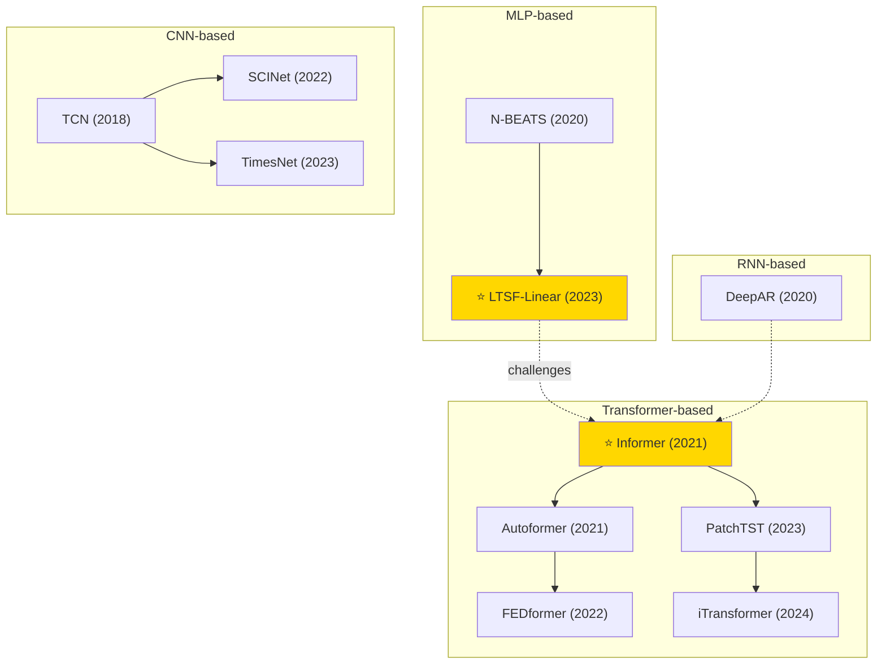

# Time Series Forecasting (TSF)

A collection of must-read time series forecasting papers from top venues.

## Tech Tree

## Contents

- [Classic Papers](classic.md) — Foundational and pioneering works
- [2024](2024.md)
- [2023](2023.md)
- [2022](2022.md)
- [2021](2021.md)
- [2020](2020.md)
