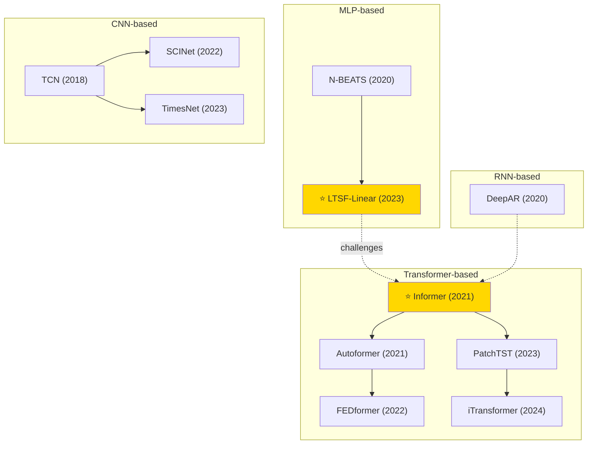

# Time Series Forecasting — Tech Tree

## Key Evolution Paths

| Path | Description |
|------|-------------|
| **Transformer** | Informer → Autoformer → FEDformer (frequency) → PatchTST (patching) → iTransformer (inverted) |
| **MLP** | N-BEATS → LTSF-Linear (challenged Transformer dominance) |
| **CNN** | TCN → SCINet / TimesNet (2D temporal modeling) |
| **RNN** | DeepAR (probabilistic autoregressive) |
| **Key Debate** | LTSF-Linear showed simple models can beat Transformers, sparking the "Are Transformers Effective?" discussion |
